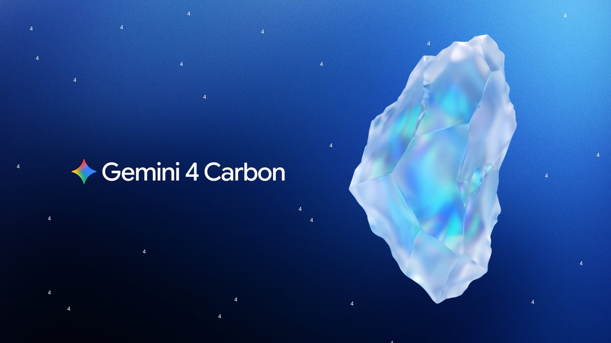
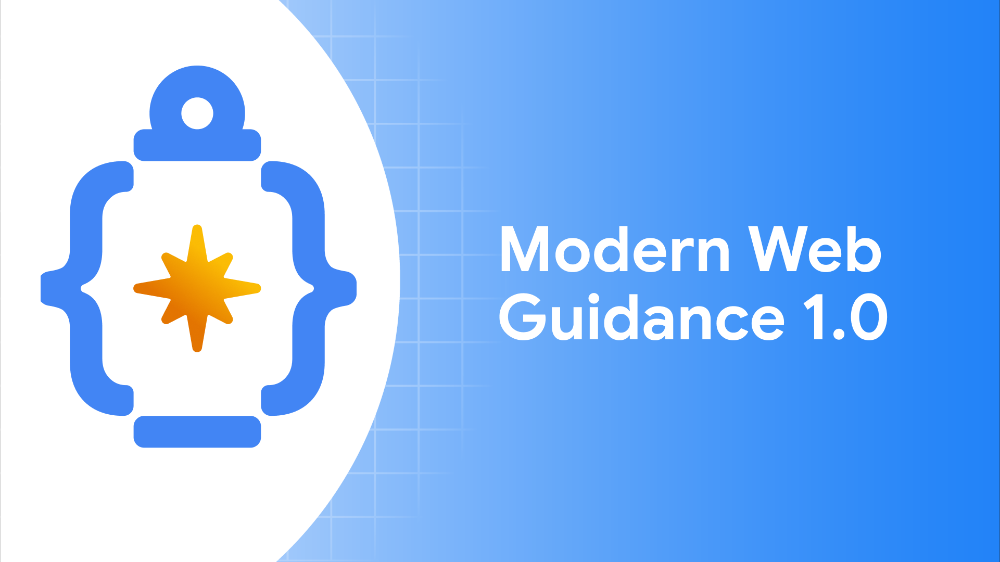

# AI Daily 2026-11-11

封面色：日落

## 今日一句话

> Gemini 4 Carbon 全面开放，Claude 做起了表格和白板，浏览器厂商开始给 coding agent 写官方指南：agent 正在接手越来越完整的工作。

## 今日要闻

### 1. Google: Gemini 4 Carbon 全面开放，Antigravity 同步预览多 agent 编排 /swarm
- 来源链接：[Google 官方博客](https://blog.google/innovation-and-ai/models-and-research/gemini-models/gemini-4-carbon-now-available/)；[Antigravity /swarm 文档](https://antigravity.google/docs/swarm)；[Hacker News 讨论](https://news.ycombinator.com/item?id=50442303)
- 类型：模型发布
- 推荐指数：★★★★★
- 配图：（图源：Google）
- 关键数字：2 美元 | 每百万输入 token 首发价，11 月 30 日起翻倍
- 一句话总结：Google 把旗舰模型 Gemini 4 Carbon 开放给所有付费开发者和 Google AI Ultra 订阅用户，首发价为每百万 token 输入 2 美元、输出 10 美元，11 月 30 日后翻倍。

**为什么重要：** 两周前 Carbon 只通过 Fairwind 项目提供给少数网络安全防御方，现在进入了 AI Studio API、Gemini 应用和搜索的 AI 模式。Google 把它放在 Gemini 4 Argon 之上：大多数编程和知识工作继续用 Argon，最难的多步骤编码、调试和科研交给 Carbon，后者会花更多 token 做探索和验证。同一天预览的 /swarm 让一条 prompt 变成一组并行工作的 agent，Carbon 适合担任其中的架构、协调和审查角色。

**核心观点：**
1. Google 称 Carbon 在 CursorBench 4.0、Perplexity 的 WANDR 和 Zapier 的 AutomationBench 上排名第一，单任务成本不到次优外部模型的一半。
2. 首发价与 Argon 相同，每百万输入 token 2 美元、输出 10 美元；2026 年 11 月 30 日起涨到 4 美元和 20 美元。
3. /swarm 让当前对话充当协调者，把任务拆给多个 worker 并行处理，在共享留言板上协作，再由验证 agent 测试改动。它目前是预览版，面向 Google AI Pro 和 Ultra 用户，Antigravity 应用和 CLI 都能用。

**这意味着什么：** 前沿模型的分层越来越清楚：便宜的主力模型处理大多数任务，贵而慢的模型只在关键环节出场。/swarm 把这种分工做成了产品功能，开发者要考虑的不再只是用哪个模型，而是哪一步用哪个模型。首发价只维持 20 天，基于 Carbon 做成本测算时应按 11 月 30 日之后的价格算。

**风险与待验证：** 三项基准排名和成本对比都来自 Google 的发布稿，还没有独立复测。/swarm 处于预览阶段，官方文档提醒每个 worker 都是独立的 agent，额度消耗比单个对话快得多。

### 2. Anthropic: Claude 推出表格、白板和数据看板，合作方应用可直接嵌进对话
- 来源链接：[Claude 官方博客](https://claude.com/resources/articles/more-ways-to-work-with-claude-sheets-whiteboards-and-interactive-connectors)；[Sheets、Whiteboards 与 Data 说明](https://claude.com/resources/articles/sheets-whiteboards-data)；[Hacker News 讨论](https://news.ycombinator.com/item?id=50443716)
- 类型：产品更新
- 推荐指数：★★★★★
- 配图：（图源：Anthropic）
- 关键数字：9000+ | Claude Marketplace 上的连接器和插件
- 一句话总结：Claude 所有付费套餐上线 Claude Sheets 和 Claude Whiteboards 测试版，原 Claude Dashboards 正式发布并改名 Claude Data；Adobe、Atlassian 等合作方的应用也能直接在 Claude 里操作。

**为什么重要：** 过去用 Claude 做计划或分析，结果往往要复制到别的工具里再和同事协作，Claude 也就看不到后续的改动。这次 Anthropic 把表格、白板和看板做成 Claude 里的共享成果物，团队可以和 Claude 一起持续编辑，需要时再导出到合作方工具。加上升级后的交互式连接器，Claude 正在从回答问题的助手变成团队干活的地方。

**核心观点：**
1. Claude Sheets 能生成带多个标签页、公式、格式和下拉菜单的表格。Claude Whiteboards 能把会上的讨论整理成带负责人和日期的时间线，再转成文档或演示稿，或导入 Lucid、Miro 和 Zoho 的 Vani。
2. Claude Data 连接 Snowflake、Salesforce 等数据源，可以使用数据团队认证过的指标定义（测试版），生成看板、可视化数据故事或带旁白的短视频。
3. 交互式连接器允许合作方把应用嵌进 Claude，首批有 Adobe 和 Atlassian；Salesforce（测试版）、NetSuite 和 Workday（测试版）的插件自带技能。Claude Marketplace 已有超过 9000 个连接器和插件。

**这意味着什么：** 表格、白板和 BI 看板是办公软件里用户最多的几类工具，Anthropic 直接进入了 Microsoft、Google 和各家 SaaS 的地盘。

**风险与待验证：** Sheets 和 Whiteboards 仍是测试版，Salesforce 和 Workday 插件也是测试版。官方预告的 Claude Meetings 还没有上线时间。团队协作会涉及企业数据权限，正式采用前要先确认管理员控制和数据留存策略。

### 3. 浏览器厂商: Modern Web Guidance 1.0 发布，给 coding agent 补上现代 Web 知识
- 来源链接：[Chrome 开发者博客](https://developer.chrome.com/blog/modern-web-guidance-v1)；[GitHub 仓库](https://github.com/GoogleChrome/modern-web-guidance)；[Hacker News 讨论](https://news.ycombinator.com/item?id=50443812)
- 类型：开源项目
- 推荐指数：★★★★☆
- 配图：（图源：Chrome for Developers）
- 关键数字：4 个团队 | Chrome、Edge、Firefox 和 MDN 共同维护
- 一句话总结：Chrome、Edge、Firefox 和 MDN 团队共同维护的 Modern Web Guidance 发布 1.0 稳定版，以 agent 技能的形式把现代浏览器 API 的用法和兼容性数据注入 coding agent 的上下文。

**为什么重要：** 大模型的训练数据里旧代码远多于新代码，所以 coding agent 写网页时常用笨重的 JavaScript 去实现浏览器早已原生支持的功能。Modern Web Guidance 在 5 月的 Google I/O 上发布预览版，1.0 版本由四个 Web 平台团队共同提供一份经过专家审核的现代写法参考。

**核心观点：**
1. 1.0 新增现代化流程，扫描已有代码库，找出可以安全换成新 Web 特性的旧写法，命令是 `npx modern-web-guidance@latest legacy-scan .`。
2. 指南库针对数百个经过验证的 AI 知识盲区，每条指南都要经过对应领域技术负责人签字，面向用户的指南还有专门的无障碍审核。
3. 所有指南都有评测，并公开评测看板，对比 agent 用和不用这套指南的结果。

**这意味着什么：** 给 agent 补知识的方式正在从等下一代模型变成装一个技能包。由平台方而不是第三方来写这类技能包，内容能跟着浏览器版本更新。云服务、支付、数据库这类平台型公司很可能跟进，为自家 API 发布官方的 agent 技能。

**风险与待验证：** 评测看板由项目方维护，改进幅度还没有第三方复现。指南会进入 agent 的上下文并占用 token，官方称已按评测结果做了精简，大型项目里的实际开销需要自己测。

## 快讯

1. **Google DeepMind · AlphaProof Code**：AI agent 用 4 周完成 Signal 核心加密代码的形式化验证，写出数百万行 Lean 证明，只有约 1% 需要人工复查。[来源](https://deepmind.google/blog/introducing-alphaproof-code/)
2. **MiniMax · H3-Image 开放权重**：10 秒内生成 4096×4096 图像，最多支持 16 张参考图，API 定价为同类服务的 50–70%。[来源](https://www.minimax.io/blog/minimax-h3-image)
3. **ElevenLabs · Scribe v3**：语音转写的词错误比 v2 少 27%，覆盖 102 种语言；实时版首次支持区分说话人。[来源](https://elevenlabs.io/blog/scribe-v3)
4. **Amazon · Mitra-v2**：用合成数据预训练的表格基础模型，Amazon 称它在 51 个数据集组成的 TabArena 上单模型排名第一，已开源。[来源](https://www.amazon.science/blog/mitra-v2-scaling-synthetic-pretraining-for-tabular-foundation-models)
5. **OpenAI · Businesses in ChatGPT**：商家可以管理自己在 ChatGPT 中展示的信息，并查看自己在 ChatGPT 里的呈现情况。[来源](https://openai.com/index/introducing-businesses-chatgpt)

## 值得研究的开源项目

1. 项目名：meta/astryx
   GitHub 链接：[meta/astryx](https://github.com/meta/astryx)
   Star 数：约 2.4 万（2026-11-11）
   解决什么问题：Meta 开源的 React 设计系统，内部用了 8 年、支撑超过 1.3 万个应用，提供 150 多个无障碍组件、主题和 CLI。
   为什么值得看：文档、API 和 CLI 是按人和 agent 共用同一份参考来设计的，可以看到大型设计系统怎样为 coding agent 做准备。目前是 Beta 版。
2. 项目名：vercel-labs/agent-browser
   GitHub 链接：[vercel-labs/agent-browser](https://github.com/vercel-labs/agent-browser)
   Star 数：约 5.0 万（2026-11-11）
   解决什么问题：用 Rust 写的命令行浏览器，让 agent 一条命令一条命令地打开页面、读取内容、点击元素。
   为什么值得看：`snapshot` 把页面转成紧凑的无障碍树文本，每个元素带一个编号（如 `@e1`），agent 按编号操作，不必依赖截图。
3. 项目名：addyosmani/agent-skills
   GitHub 链接：[addyosmani/agent-skills](https://github.com/addyosmani/agent-skills)
   Star 数：约 11.6 万（2026-11-11）
   解决什么问题：一组面向 AI coding agent 的工程技能，覆盖规格、计划、构建、测试、评审和发布。
   为什么值得看：把资深工程师的工作流和质量关卡写成 9 个斜杠命令，例如 `/spec`、`/test`、`/review`，适合用来学习怎样写 agent 技能。
