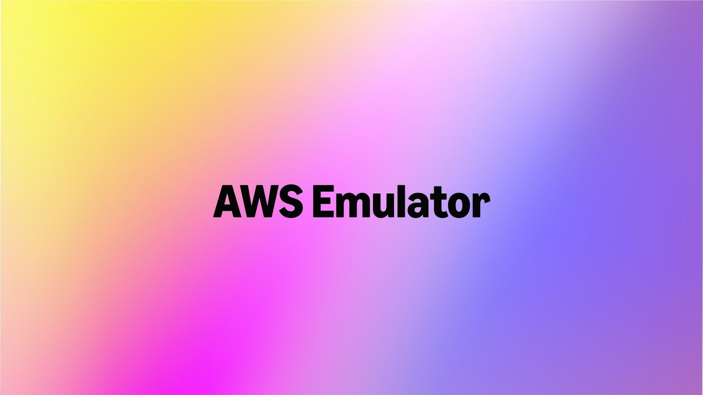
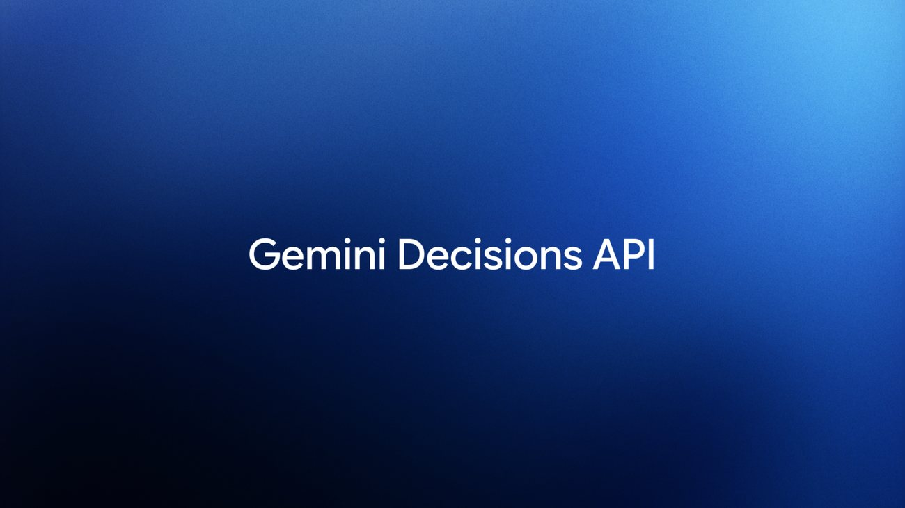

# AI Daily 2026-11-12

封面色：靛蓝

## 今日一句话

> Gemini 开放一次可判上千个问题的决策 API，AWS 放出能离线模拟两百多项服务的本地环境，百度的 ERNIE 5.5 Flash 预览也已能调用。

## 今日要闻

### 1. AWS: 发布 AWS Emulator，agent 写好的本地云环境可以离线测试
- 来源链接：[Werner Vogels 博客](https://www.allthingsdistributed.com/2026/11/aws-emulator-and-the-engineers-job-when-agents-write-the-code.html)；[用户指南](https://docs.aws.amazon.com/emulator/latest/userguide/what-is-service.html)；[GitHub 仓库](https://github.com/aws/aws-emulator)；[Hacker News 讨论](https://news.ycombinator.com/item?id=50456631)
- 类型：开源项目
- 推荐指数：★★★★★
- 一句话总结：AWS 发布本地模拟器 AWS Emulator，用 400 多个公开 API 模型覆盖 200 多项服务，本机离线运行，不需要 AWS 账号，代码以 CC0 开放。
- 配图：（图源：AWS）
- 关键数字：200+ | 项服务可在本机离线模拟

**为什么重要：** 调用 AWS 的程序以前要打到真实云上，或者只模拟少数几个服务。AWS 现在有 200 多项服务，手写一套高保真替身不现实，而 coding agent 写代码的速度已经快过人工在生产环境里逐项核对。AWS Emulator 把这套替身放到本机：请求打到模拟器，不打到 AWS，agent 可以在写完一段代码后自己跑测试。

**核心观点：**
1. 模拟器由 400 多个公开 API 模型生成，覆盖 200 多项 AWS 服务。AWS 称代码全部由 agent 编写和测试；工程师负责脚手架、对照真实 AWS 的保真测试，以及合并前的审查。
2. 程序在本机离线运行，不另收服务费，也不需要 AWS 账号，许可证为 CC0。用户指南写明它只用于构建和测试，不能用于生产或安全测试。
3. 2026-11-12 查询 GitHub，aws/aws-emulator 有 1,713 个 star，许可证为 CC0-1.0，仓库创建于 2026-09-11。

**这意味着什么：** 云厂商开始把「让 agent 自己验证」做成可以下载的基础设施。开发者可以把一部分集成测试从账号和费用里拆出来。AWS 同时公开了写法：规格和对照真实服务的测试在前，agent 写实现，合并门禁决定什么能进仓库。工程师要管的是这些门禁，而不只是下一行业务代码。

**风险与待验证：** 保真度取决于公开 API 模型和对照真实 AWS 的测试。仓库里的 things-that-do-not-work 目录记录尚未对齐的行为。官方明确不要用它做生产或安全测试。「代码全部由 agent 编写」是 AWS 的自述，外部还没有逐项复核 200 多项服务的覆盖率。GitHub 显示仓库在 9 月就已创建，这次是公开博客里的发布，不是仓库首次出现。

### 2. Google: Gemini Decisions API 上线，一次最多评判 1,000 个问题
- 来源链接：[Google 官方博客](https://blog.google/innovation-and-ai/technology/developers-tools/gemini-decisions-api/)；[Decisions API 文档](https://aistudio.google.com/docs/decisions-api)；[Simon Willison 实测](https://simonwillison.net/2026/Nov/11/gemini-decisions-api/)；[Hacker News 讨论](https://news.ycombinator.com/item?id=50456791)
- 类型：模型发布
- 推荐指数：★★★★★
- 一句话总结：Google 在 Gemini API 中上线 Gemini Decision 1，对文本、图像、音频、视频和 PDF 一次最多评判 1,000 个封闭问题，输入每百万 token 0.10 美元，输出不计费。
- 配图：（图源：Google）
- 关键数字：0.10 美元 | 每百万输入 token，输出免费

**为什么重要：** 路由、策略检查和内容打分以前通常要让生成式模型逐 token 写出答案，延迟和输出费用都跟着答案长度走。Decisions API 把这类封闭判断做成单独端点：同一份多模态输入上可以挂很多个是否、选择或量表问题，模型一次前向计算给选项打分，不生成一段解释。Google AI Studio 现在可以取 API key 调用，并提供用于原型的不计费档。

**核心观点：**
1. 模型 ID 为 gemini-decision-1。单次请求的共享输入上限是 256K token，问题上限是 1,000 个；类型包括是否判断、多选和量表评分，每个答案带 0 到 1 的置信度。
2. 定价为每百万输入 token 0.10 美元、输出 0 美元，共享输入只计一次。Google 称，在最多 16K token 的上下文上，模型计算的中位延迟为 50–100 毫秒，端到端为 150–250 毫秒，问题数从 1 增到 100 时延迟几乎持平。
3. Google 称，在涵盖 agent 路由、推理、排序和多模态理解的基准上，Gemini Decision 1 领先且校准误差最低；相对用 Interactions API 调用的 Gemini 3.5 Flash-Lite，同一套基准上的成本将近低 5 倍。OpenRouter、LangChain、Vercel、LiteLLM 等集成正在推出，Google Cloud 上的支持仍未落地。

**这意味着什么：** 应用不必把「选哪个工具、过不过策略、这段上下文有没有用」都写成一次文本生成。置信度让程序可以把含糊结果交给另一个模型或人工。按输入计费、输出免费之后，一次请求里多问几个问题的边际成本主要是问题本身的 token。它服务的是已经出现的决策接口这一类需求，Gemini 补上的是多模态和现成的 API 渠道。

**风险与待验证：** 「领先」「校准误差最低」和「成本将近低 5 倍」都来自 Google 的基准，还没有独立复测。博客里的示例使用 API 版本 v1beta。Google Cloud 上的 Gemini 支持官方写的是即将推出。Simon Willison 只用自己的一段视频做过抽查，不能代替那套基准。

### 3. 百度: ERNIE 5.5 Flash Preview 开放 API，权重将按 Apache 2.0 放出
- 来源链接：[ERNIE 发布页](https://ernie.baidu.com/release/ernie-5-5-flash-preview/)；[千帆模型页](https://console.bce.baidu.com/qianfan/modelcenter/model/buildIn/detail/am-abe18d298d70)
- 类型：模型发布
- 推荐指数：★★★★☆
- 一句话总结：百度发布 ERNIE 5.5 Flash Preview，总参数 280B、每次激活 14B、上下文 1M token，API 已在千帆可用，权重将以 Apache 2.0 开放，后训练尚未完成。
- 配图：（图源：百度）
- 关键数字：280B | 总参数，每次激活 14B

**为什么重要：** 这是百度在早前的 ERNIE 5.5 Flash Base 之上放出的第一个后训练模型。开发者现在可以在千帆上调用它做编程、三维建模、知识工作和内容生成；权重还要等后续按 Apache 2.0 开放。稀疏激活的预览模型由此从基座说明变成可以发起请求的 API。

**核心观点：**
1. 发布页给出的规格是总参数 280B、激活参数 14B、上下文 1M token。API 已在千帆上线。权重将以 Apache 2.0 协议开放，页面没有写开源日期。
2. 发布页在游戏示例里写明它是纯文本模型，看不见屏幕，因此把试玩中发现的问题改写成代码测试再迭代。示例提到 Unreal Engine、Unity、Godot，以及 Blender 和 FreeCAD。
3. 金融和法律等方向的训练使用了 30 万个工作区、1,000 万份参考文件、40 多种文件类型；视频方向建了超过 15 万个创作环境。这些数字都出自百度的发布页。

**这意味着什么：** 预览模型可以按「API 先开放、权重后开放」交付。能调用，应用就可以试长程编程和工具链；看不到权重，就不能做本地部署，也难以独立复现演示。发布页里的游戏、建筑和报告都是百度自己跑完的端到端示例，用法是 agent 加外部工具，不是单轮对话。

**风险与待验证：** 官方称这是后训练的中间检查点，训练还没结束，部分能力可能仍然不足。演示和基准都是厂商自测，没有独立复现。Apache 2.0 权重只说即将开放，文件落地之前不能把它当成已开源模型。发布页没有给出单价、区域和速率，这些要以千帆控制台为准。

## 快讯

1. **NVIDIA · Snapshot 开源**：OpenShell 捐入 CNCF Sandbox；Crusoe 称在 HGX B300 上把 GLM-5.3 的就绪时间从约 8 分钟降到 31 秒。[来源](https://blogs.nvidia.com/blog/open-source-openshell-infrastructure/)
2. **Frigade · Yogurt**：本地 AI 会议记录开源应用，录音时不把机器人拉进会议，提供 macOS、Windows 和 Linux 安装包。[来源](https://github.com/FrigadeHQ/yogurt)

## 值得研究的开源项目

1. 项目名：homeassistant-ai/ha-mcp
   GitHub 链接：[homeassistant-ai/ha-mcp](https://github.com/homeassistant-ai/ha-mcp)
   Star 数：7,358（2026-11-12）
   解决什么问题：用 MCP 让 Claude、ChatGPT 等助手配置和自动化 Home Assistant，README 标出 87 个工具。
   为什么值得看：它把智能家居的改配置做成助手可调用的工具，而不是一段只能复制的建议。今日 GitHub Trending 上仍在升温，许可证为 MIT。
2. 项目名：NVIDIA/auto-ontology
   GitHub 链接：[NVIDIA/auto-ontology](https://github.com/NVIDIA/auto-ontology)
   Star 数：11,830（2026-11-12）
   解决什么问题：从企业元数据生成知识图谱，用 MCP、CLI 和 API 告诉 agent 数据在哪、指标是什么意思、该不该用。
   为什么值得看：分析类 agent 容易把算得快当成答得对。这个库把指标定义从提示词里拆出来，接到已有的语义模型上。许可证为 Apache-2.0。
3. 项目名：google/skills
   GitHub 链接：[google/skills](https://github.com/google/skills)
   Star 数：23,937（2026-11-12）
   解决什么问题：提供可安装的 agent 技能，覆盖 Google Cloud 等 Google 产品和技术。
   为什么值得看：一条 `npx skills add google/skills` 就能装进 coding agent，并可以选择装哪些技能、装到项目还是全局。仓库在 2026-11-11 仍有推送。许可证为 Apache-2.0。
