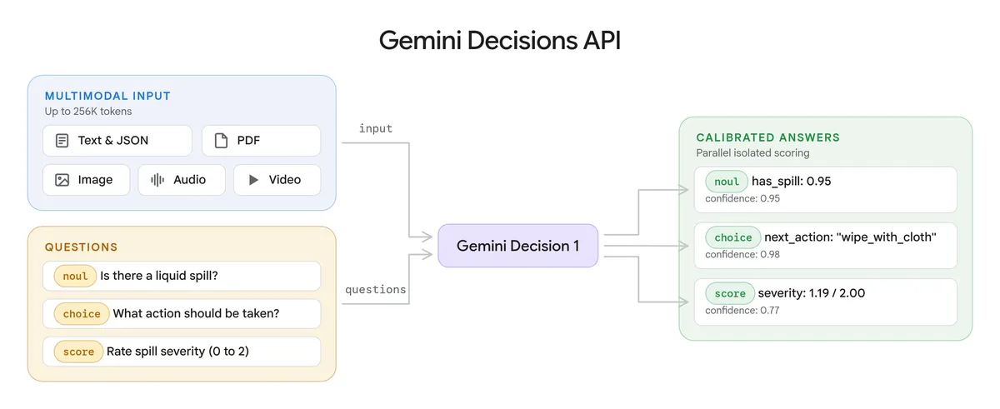

# AI Daily 2026-11-12

封面色：靛蓝

## 今日一句话

> 两条已经有人走了很久的路，今天都迎来了大厂官方版本：Google 跟进 Jev 做决策模型，AWS 跟进 LocalStack 做本地云模拟。先发者的护城河要重新算。

## 今日要闻

### 1. AWS: 发布 AWS Emulator，官方版本进入 LocalStack 做了十年的赛道
- 来源链接：[Werner Vogels 博客](https://www.allthingsdistributed.com/2026/11/aws-emulator-and-the-engineers-job-when-agents-write-the-code.html)；[用户指南](https://docs.aws.amazon.com/emulator/latest/userguide/what-is-service.html)；[GitHub 仓库](https://github.com/aws/aws-emulator)；[Hacker News 讨论](https://news.ycombinator.com/item?id=50456631)
- 类型：开源项目
- 推荐指数：★★★★☆
- 一句话总结：AWS 发布本地模拟器 AWS Emulator，覆盖 200 多项服务，本机离线运行，不需要 AWS 账号，代码以 CC0 放入公有领域；AWS 称全部代码由 agent 编写和测试。
- 关键数字：CC0 | 公有领域；LocalStack 同等覆盖的付费版每席每月 39 美元起

**为什么重要：** 在本机模拟 AWS 不是新需求。moto 从 2013 年起做 Python 测试里的 AWS mock，LocalStack 从 2016 年起做完整的本地 AWS 栈，GitHub 上有 6.5 万 star，是这个领域的事实标准；LocalStack 免费的 Hobby 版只有 30 多项服务，55 项以上要付费。AWS 今天自己下场：200 多项服务、离线、免费、CC0。Vogels 博客里 Swami 的说法是，AWS 服务太多，靠人手写高保真替身要花几年，所以这套模拟器从 400 多个公开 API 模型出发，由 agent 批量生成，再由 agent 对照真实 AWS 跑保真测试，工程师只负责规格、测试和合并门禁。

**核心观点：**
1. 覆盖 200 多项服务，由 400 多个公开 API 模型生成。Linux 下装 RPM 或 Debian 包直接运行，macOS 和 Windows 走 Docker，Rust 测试还能以库的形式嵌入进程。
2. 许可证是 CC0-1.0，不是 Apache 或 MIT，意味着连署名要求都没有。用户指南明确写了只用于构建和测试，不能用于生产或安全测试。
3. 仓库 2026 年 9 月 11 日创建，11 月 11 日公开发布，当天 GitHub 1,900 多个 star，Hacker News 650 多分。每个版本随发布公布各服务的保真度分数，没对齐的行为记录在 `issues/things-that-do-not-work/` 目录。

**这意味着什么：** 这是平台方用免费官方版覆盖第三方生态位的又一例，和 Chrome 做 Modern Web Guidance、Google 做 Decisions API 是同一个模式。LocalStack 的免费版在服务数量上已经被远远超过，付费版的卖点只剩 Snowflake、Azure 模拟和团队协作功能。更值得注意的是生产方式：AWS 公开说这套代码是 agent 写的、agent 测的，人只守门禁。这是大厂第一次把「agent 写的基础设施」当成正式产品发布，而不是实验项目。如果保真度跟得上，其他云厂商没有理由不跟。

**风险与待验证：** 保真度取决于公开 API 模型和对照真实 AWS 的测试，各服务差异大，官方的保真度分数要逐个看。「代码全部由 agent 编写」是 AWS 自述，外部没有逐项复核。HN 190 条评论里有 24 条在和 LocalStack 比较，普遍关心的是 IAM、事件顺序这类难模拟的部分是否可靠。

### 2. Google: Gemini Decisions API 上线，决策模型这条线走到第三家大厂
- 来源链接：[Google 官方博客](https://blog.google/innovation-and-ai/technology/developers-tools/gemini-decisions-api/)；[Decisions API 文档](https://aistudio.google.com/docs/decisions-api)；[Simon Willison 实测](https://simonwillison.net/2026/Nov/11/gemini-decisions-api/)；[Hacker News 讨论](https://news.ycombinator.com/item?id=50456791)
- 类型：模型发布
- 推荐指数：★★★★☆
- 一句话总结：Google 在 Gemini API 中上线 Gemini Decision 1，对文本、图像、音频、视频和 PDF 一次最多评判 1,000 个封闭问题，每百万输入 token 0.10 美元，输出不计费。
- 配图：（图源：Google）
- 关键数字：第 3 家 | Jev 9 月、OpenAI 10 月之后，Google 是第三家做决策模型的大厂

**为什么重要：** 「决策模型」这条线不到两个月已经走到第三家大厂。9 月 15 日 TypeSafe 发布 Jev，第一次把「不生成文字、只对给定选项输出概率」做成独立模型；10 月 6 日 OpenAI 用 GPT-6 Luna 推出 Decisions API 公测，10 月 22 日正式可用；10 月 25 日 Parallel 在同类接口上加了实时网页检索；11 月 10 日 Hugging Face 给 transformers 加了 `decision` pipeline，社区也把名字从 System One 统一成 decision model。Google 今天入场，接口形态和 Jev 几乎一样，连是否题的字段名 noul 都沿用了 Jev 的叫法。

**核心观点：**
1. 模型 ID 为 gemini-decision-1。单次请求共享输入上限 256K token，问题上限 1,000 个；三种题型是 noul（是否）、choice（多选，2 到 255 个选项）、score（有序量表），每个答案带 0 到 1 的置信度。
2. 定价每百万输入 token 0.10 美元、输出 0 美元，和 OpenAI 持平；Jev 是 0.042 美元，仍是三家里最便宜的。模态上 Jev 只收文本，OpenAI 收文本和图片，Gemini 收音频、视频和 PDF。
3. Google 称在涵盖 agent 路由、推理、排序和多模态理解的基准上领先且校准误差最低，相对用 Interactions API 调用的 Gemini 3.5 Flash-Lite 成本低近 5 倍。OpenRouter、LangChain、Vercel、LiteLLM 等集成正在推出，Google Cloud 上的支持是「即将」。

**这意味着什么：** 三家大厂在同一个接口形态上对齐，说明「把路由、策略检查、打分从文本生成里拆出来」已经不是某一家的设计选择，而是新的接口层。对开发者，选型问题从「用不用决策模型」变成「哪家的模态和延迟匹配自己的输入」。对 TypeSafe 这样的先发者，差异化只剩价格和更早的生态，这是上游大厂跟进后小公司通常会遇到的处境。下一步值得盯的是 Anthropic 和 Meta 会不会跟进，以及 Ollaya、Jeeves 这类 Jev 兼容的开源工具能不能把接口标准化。

**风险与待验证：** 「领先」「校准误差最低」和「成本低近 5 倍」都来自 Google 的基准，没有独立复测。示例代码用的是 v1beta。Simon Willison 只用一段视频做了抽查，注意到 Gemini 对是否题给的是 0.92、0.08 这类概率，而 Jev 和 OpenAI 都给 1.0 或 0.0，三家的「置信度」含义不完全一样，跨家比较要小心。

### 3. 阿里: 官宣 Qwen4，Qwen4-Max 预览版同日上线 Token Plan
- 来源链接：[Qwen 官方推文](https://x.com/Alibaba_Qwen/status/2120335993643684315)；[千问公众号](https://mp.weixin.qq.com/s/J_zbVHa2R3mmY5KD4v3-bw)；[Token Plan](https://platform.qianwenai.com/pricing/token-plan)
- 类型：模型发布
- 推荐指数：★★★★☆
- 一句话总结：阿里宣布新一代千问大模型 Qwen4 即将发布，Qwen4-Max 预览版当天上线 Token Plan，千问办公、Qoder、千问 App、Qwen Studio 同步接入，正式版「不久后发布」。
- 关键数字：5 周 | Qwen3.8 系列权重 11 月 7 日还在更新，Qwen4 已进入预览

**为什么重要：** 这是国内第一梯队的换代信号。Qwen3.8 系列（2.4T-A95B、Flash-Next、27B）的权重 11 月 7 日还在更新，五周前才发布，Qwen4 就进入预览。官方给的方向是知识和世界理解、编程、Agent 能力和专业软件操作，和 Google 前两天给 Gemini 4 Carbon 的定位（长程 agent 任务、复杂软件工程）几乎重合。预览版不是只给看的：Token Plan 订阅用户今天就能调，Qoder 里的匿名测试模型 Qoduck 也已切到这个版本。

**核心观点：**
1. 官方推文和公众号都发在 11 月 11 日上午 10 点左右（北京时间）。预览版名为 Qwen4-Max，正式版时间只说「不久后」。
2. 当前可用渠道：阿里 Token Plan（个人版每月 3 美元起，预览期限时折扣）、千问办公、Qoder、千问 App、Qwen Studio。没有开放权重，也没有独立的 API 定价页。
3. 同一天阿里还发了 Qwen Code 1.0 Preview（GitHub release 11 月 11 日），把 Qoder 里的 Harness 能力并入终端编程 agent，是给 Qwen4 配套的工具侧动作。

**这意味着什么：** 国内厂商的换代节奏在跟美国同步：Google 11 月 10 日全面开放 Gemini 4 Carbon，阿里 11 月 11 日预览 Qwen4，百度同日放出 ERNIE 5.5 Flash 的后训练预览。三家都把「长程 agent 任务」和「专业软件操作」写进第一句，说明下一代模型的竞争点已经从对话质量转到能不能替人把一个完整任务做完。阿里这次先放订阅渠道、再谈权重，和 Qwen3 时代「先开源再商用」的顺序反了过来，值得观察正式版会不会延续。

**风险与待验证：** 预览版没有公布参数、上下文长度和基准数据，官方只有「实际任务测试中眼前一亮」这类表述。能力评价要等正式版和第三方测评。Token Plan 的限时折扣和具体额度以官网为准。

## 快讯

1. **Google DeepMind · AlphaGenome 2**：新一代 DNA 序列模型，能预测基因变异对数百种人类细胞类型的影响，识别出的表达改变变异数量接近前代两倍，面向非商业研究开放。[来源](https://deepmind.google/blog/alphagenome-2-deciphering-how-cells-read-dna-to-better-understand-disease)
2. **Runway · Praxis-1 开放权重**：27B 参数的世界动作模型以 Apache 2.0 放出，同时预测视频和机器人动作，Runway 称在 NVIDIA RoboLab-120 上成功率 46.2%，高于 FLUX 3 Action 的 42.9%。[来源](https://runway.com/news/company-news/praxis-1-is-now-available)
3. **百度 · ERNIE 5.5 Flash Preview**：在 11 月 5 日发布的 Flash Base 之上的第一个后训练检查点，280B 总参数、14B 激活、1M 上下文，API 已上千帆，权重「即将」按 Apache 2.0 开放，官方说明训练尚未完成。[来源](https://ernie.baidu.com/release/ernie-5-5-flash-preview/)
4. **NVIDIA · OpenShell 捐入 CNCF**：这个用于隔离和管控自主 agent 的开源运行时进入 CNCF Sandbox；同场发布的 NVIDIA Snapshot 组件把 GLM-5.3 在 HGX B300 上的就绪时间从约 8 分钟降到 31 秒（Crusoe 测试）。[来源](https://blogs.nvidia.com/blog/open-source-openshell-infrastructure/)
5. **Google · Antigravity Browser use**：agent 可以用内置浏览器打开网页、截图、验证改动，App 和 CLI 都在滚动推送，登录和下载由用户把关。[来源](https://antigravity.google/docs/browser)

## 值得研究的开源项目

1. 项目名：aws/aws-emulator
   GitHub 链接：[aws/aws-emulator](https://github.com/aws/aws-emulator)
   Star 数：1,925（2026-11-12）
   解决什么问题：本机离线模拟 200 多项 AWS 服务，给测试和 coding agent 一个不花钱、不碰生产的 AWS。
   为什么值得看：README 里有 `aws agent-toolkit add-skill --skill-name aws-emulator` 一行装进 coding agent 的路径；`issues/things-that-do-not-work/` 目录是看一个 agent 写的大型项目怎么管理已知缺陷的样本。许可证 CC0-1.0。
2. 项目名：shadcn/improve
   GitHub 链接：[shadcn/improve](https://github.com/shadcn/improve)
   Star 数：10,365（2026-11-12）
   解决什么问题：一个 agent 技能，用最强的模型审计代码库、写出实施计划，再交给便宜的模型执行。
   为什么值得看：它把「贵模型出主意、便宜模型干活」做成了 `/improve` 一条命令，计划是纯 markdown，任何 agent 都能接。今日 GitHub Trending 在榜。许可证 MIT。
3. 项目名：homeassistant-ai/ha-mcp
   GitHub 链接：[homeassistant-ai/ha-mcp](https://github.com/homeassistant-ai/ha-mcp)
   Star 数：7,386（2026-11-12）
   解决什么问题：用 MCP 让 Claude、ChatGPT 等助手直接配置和自动化 Home Assistant，README 列出 87 个工具。
   为什么值得看：智能家居是 MCP 落到消费者场景的少数例子之一，可以看一个有状态的真实系统怎么暴露成 agent 工具。今日 GitHub Trending 在榜。许可证 MIT。
