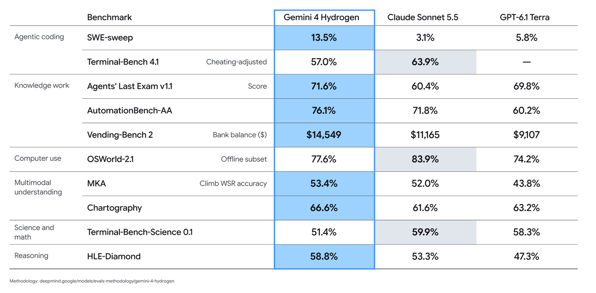

# AI Daily 2026-11-13

封面色：青绿

## 今日一句话

> 便宜的执行模型进了搜索框：Gemini 4 Hydrogen 全球上线，并开始在同一次任务里和 Carbon 来回交接。

## 今日要闻

### 1. Google: Gemini 4 Hydrogen 上线，效率档进入搜索并和 Carbon 同会话分工
- 来源链接：[Google 发布稿](https://blog.google/innovation-and-ai/models-and-research/gemini-models/introducing-gemini-4-hydrogen/)；[API 定价](https://ai.google.dev/gemini-api/docs/pricing#gemini-4-hydrogen)；[Antigravity：Orchestrator](https://antigravity.google/blog/gemini-4-hydrogen-in-google-antigravity/)；[Search 升级说明](https://blog.google/products-and-platforms/products/search/gemini-4-hydrogen-search-upgrade/)
- 类型：模型发布
- 推荐指数：★★★★★
- 一句话总结：Google 发布 Gemini 4 Hydrogen（模型 ID gemini-4-hydrogen），标准付费价每百万 token 输入 1.50 美元、输出 7.50 美元，整个 100 万 token 上下文不分档；同日进入全球 Google 搜索，Antigravity 里可以和 Carbon 在同一次任务中切换。
- 配图：（图源：Google）
- 关键数字：1.50 美元 | 每百万输入 token 标准价，上下文不分档

**为什么重要：** Gemini 4 到本周仍是两档旗舰。Argon 和本周已全面开放的 Carbon 承接难任务；定价页上 Carbon 没有免费档，标准价在 11 月 30 日前是每百万 token 输入 2 美元、输出 10 美元，12 月 1 日起改为 4 美元和 20 美元。再往前，日常速度靠的是 Gemini 3.8 Flash。Hydrogen 补的是「更快、并且进到所有人已经在用的产品」这一层：Google 称它在默认 high 思考档的 Artificial Analysis 智力指数上是 51，高于 Argon 的 50，xhigh 档到 54。搜索团队写道，这是 Search 至今最大的一次模型升级，全球所有用户今天可用。

**核心观点：**
1. 模型 ID 为 gemini-4-hydrogen。输入上下文 100 万 token，输出最长 100 万 token。思考档为 low、medium、high（默认）和新增的 xhigh。标准付费价是每百万 token 输入 1.50 美元、输出 7.50 美元（含思考 token）；定价页同时列出免费档，输入和输出标为不收费。Batch 与 Flex 为每百万 token 0.75 / 3.75 美元，Priority 为每百万 token 2.70 / 13.50 美元。发布稿说的「一口价」指的是 100 万 token 上下文不再按长度加价。
2. 入口分开算。开发者走 Gemini API，在 AI Studio 和 Android Studio 里调用；Gemini 应用和全球 Google 搜索面向所有用户。免费的 Gemini 应用用户只在自动选模认为合适时用到 Hydrogen。Antigravity 里的 Hydrogen 面向付费的 Google AI Pro 和 Ultra。Orchestrator（Carbon）和 Orchestrator（Argon）给 Ultra；Pro 只有 Orchestrator（Argon）。
3. Google 称相对 Gemini 3.8 Flash，high 默认档完成任务快 2.5 倍，Terminal-Bench 4.1 从 18.2% 提到 57%。发布页对比表把 Hydrogen 与 Claude Sonnet 5.5、GPT-6.1 Terra 放在同一档：Agents' Last Exam v1.1 为 71.6%，MKA 为 53.4%，HLE-Diamond 为 58.8%。同一张表在 Terminal-Bench 4.1（标注 cheating-adjusted）上给 Hydrogen 57.0%，Claude Sonnet 5.5 为 63.9%。

**这意味着什么：** 便宜档和旗舰档分开卖，OpenAI 和 Anthropic 的产品线里已经有。Google 今天多做的是同一次会话里的来回交接，而不是开头用一个静态路由器把整单派给某一个模型。Antigravity 的写法是：Carbon 先只读、理清依赖并写出计划，Hydrogen 再改代码、跑测试，卡住就交回 Carbon。模型博客把这组结果记在 Terminal-Bench 4.0 上，称接近 Carbon 的任务成功率，平均少用 24% 额度、快 19%；Antigravity 博客把同一组 24% 和 19% 记在 Terminal-Bench 4.1 上。对开发者，问题从「用哪一个 Gemini 4」变成「哪一步用 Carbon、哪一步用 Hydrogen」。进搜索和免费档的是便宜的这一层，Carbon 仍然没有免费档。

**风险与待验证：** 指数、速度、榜单名次和安全数字都来自 Google，没有独立复测。两篇官方文章对 Orchestrator 的 24% / 19% 用了不同的 Terminal-Bench 版本号。对比表里 Hydrogen 在 Terminal-Bench 4.1 上低于同表的 Claude Sonnet 5.5，并不是每一行都更高。定价页把免费档标成会用于改进产品，付费档标成不会。合作伙伴「快 2 到 2.8 倍、token 少 12% 到 23%」写的是相对 3.8 Flash 的早期测试。

### 2. Anthropic: Claude Meetings 进入测试，会上就能改文档和白板
- 来源链接：[Claude Meetings](https://claude.com/resources/articles/claude-meetings)；[更新日志](https://support.claude.com/en/articles/12138966-release-notes)；[使用说明](https://support.claude.com/en/articles/18325154-use-claude-meetings)
- 类型：产品更新
- 推荐指数：★★★★☆
- 一句话总结：Claude Meetings 开始向 Team 和 Enterprise 测试推送。Claude 以可见参会者加入 Google Meet，会上记笔记、回答问题，并生成文档和白板；其他视频会议平台官方称即将支持。
- 关键数字：2027-02-10 | 会上生成的文档和白板在此之前不另收费

**为什么重要：** 会议记录本身不是新事。Claude 的发布稿点名正在合作、以便会后把文字稿送出去的，就有 Gong、Attention、Granola、Fireflies.ai 和 Otter。这次的差别是人还在说话，Claude 已经在同一场会上起草文档和白板，被邀请的同事可以同时改。它接上本周刚放进 Claude 的 Sheets 和 Whiteboards。11 月 11 日这期日报记录过：当时 Meetings 只有预告，没有上线日期。帮助中心的更新日志把开始推送写在 11 月 12 日。

**核心观点：**
1. 目前只支持 Google Meet。Team 默认可以邀请 Claude，管理员能关掉；Enterprise 要管理员打开，并可只开给一部分人。测试期不向零数据保留、HIPAA-ready 配置或客户自管密钥的组织提供。
2. 默认不加入有外部访客的会，中途进来外部的人就离开。管理员可以允许外部会议；那种会上 Claude 只在聊天里发通知、不在那里回复，访客说的话仍会进入笔记和文字稿。它保存文字稿、摘要和屏幕描述，不保存音频。
3. 测试期里，笔记、文字稿，以及没有调用已连接工具的回答，不另收费；调用工具计入套餐用量。会上生成的文档、白板和其他成果，免费到 2027 年 2 月 10 日。

**这意味着什么：** 会议 AI 此前主要停在会后交一份纪要，Otter、Fireflies 和 Granola 是这一层已经在用的产品。Anthropic 把它们写成会后导出文字稿的合作方，补上的是会上就改同一份文档和白板，和本周放进 Claude 的成果物接在一起。助手如果只在会后出现，工作还是要另开一个工具；能在会上改成果物，会议本身就变成 Claude 的工作面。接下来要看 Zoom 和 Teams 会不会进支持列表，以及 2 月 10 日之后这些成果物怎么计价。企业要先过管理员开关和外部访客这两条规则。

**风险与待验证：** 这是测试推送，不是全量。只有 Google Meet。一部分组织被排除，Enterprise 也不是默认打开。和 Gong 等工具的导出，官方只说正在合作，没有日期。

### 3. IBM: 发布 LLMON，用单独词元把指令和数据拆开
- 来源链接：[IBM 在 Hugging Face 的文章](https://huggingface.co/blog/ibm-granite/llmon-an-llm-native-markup-language-now-in-granite)；[GitHub 仓库](https://github.com/generative-computing/llmon)；[8B 预览](https://huggingface.co/ibm-granite/granite-4.1-8b-llmon-preview)；[3B 预览](https://huggingface.co/ibm-granite/granite-4.1-3b-llmon-preview)
- 类型：研究
- 推荐指数：★★★★☆
- 一句话总结：IBM 发布标记语言 LLMON，并用 Granite 4.1 的 3B 和 8B 基座做了两款实验预览，让模型把指令和数据看成不同的词元；权重和工具包可下载，官方写明不用于生产。
- 关键数字：3B / 8B | 两款可下载的 LLMON 预览，官方称不用于生产

**为什么重要：** 让模型遵守结构，常见做法是 JSON schema、约束解码，或者用 chat template 把 system、user、assistant 分开。IBM 的论点是，JSON 的括号和引号跟正文共用词元，模型分不清一个引号是在关闭字段，还是出现在引文里。LLMON 用保留的特殊词元当边界，标签和正文不抢同一段词表。要执行的指令必须经过 exec 块点名；作为输入到达的数据、文档、工具定义和工具结果只供阅读。这是写进后训练的行为，不是外挂的过滤器。

**核心观点：**
1. 预览模型是 granite-4.1-3b-llmon-preview 和 granite-4.1-8b-llmon-preview，从 Granite 4.1 的 base 检查点后训练而来，不是在已经发布的 instruct 模型上再套一层。自带 chat template，普通消息列表会渲染成 LLMON，不必手写标记。
2. IBM 称在 OPI 基准上，LLMON 相对其测过的最好前沿模型多挡住 47% 的攻击，相对最好的开源模型多挡住 95%；ASB 和 StruQ 上趋势类似。文章写明这些基准测的是静态间接提示注入，没有公布对照模型的名字。
3. 仓库 generative-computing/llmon 为 Apache-2.0，提供 JSON 与 LLMON 的互转。官方写明：谁是指令、谁是数据，是学出来的行为，不是强制保证。

**这意味着什么：** 结构化输出和间接提示注入，之前主要靠提示词措辞、JSON 模式，或调用时的约束解码。IBM 把边界做进词表和后训练，3B 和 8B 今天就能换上这套模板试。如果「指令和数据用不同词元」能被独立复现，agent 框架会少依赖「请忽略文档里的命令」这种提示。它现在只在两款实验小模型上，替换不了生产里的前沿模型。值得看的是这个格式，不是这两款模型的榜单名次。

**风险与待验证：** 47% 和 95% 是 IBM 自己的相对数字，没有点名对照模型，也没有独立复测。官方写明是实验预览，不用于生产；防护是学习到的行为，不是硬保证。基准覆盖的是静态注入。

## 快讯

1. **Google · Gemini Live 登上 Apple CarPlay**：全球向所有 iOS 上的 Gemini 用户推送，车机里可以用语音处理邮件、日历和头脑风暴，对话同步回手机。此前已在 Android Auto 和带 Google 的车机上线。[来源](https://blog.google/innovation-and-ai/products/gemini-app/gemini-on-apple-carplay/)
2. **Google · Managed Agents 可接自托管沙箱**：Gemini API 的托管 agent 可以改在用户自己的环境里执行工具，沙箱经出站 HTTPS 连接，不需要入站端口；文档列出 Cloud Run、E2B、Modal 等接法。[来源](https://aistudio.google.com/docs/agent-environment)
3. **OpenAI · 桌面版 ChatGPT 上线 Finances**：官方账号宣布桌面应用可以查看支出、寻找省钱方式、解读投资，并搭建自定义财务工具，Free、Go、Plus 和 Pro 可用。[来源](https://x.com/ChatGPT/status/2120604108893896965)
4. **Anthropic · 自托管 Claude Managed Agents 私人测试**：harness、沙箱、凭证和会话记录可以放在自己的云或机房，模型请求可选 Anthropic、Amazon Bedrock、Google Agent Platform 或 Microsoft Foundry。[来源](https://claude.com/resources/articles/self-hosted-claude-managed-agents)
5. **Anthropic · Claude for Manufacturing**：插件含 17 个技能，连接 Autodesk Fusion、Infor、Microsoft 365 和 Oracle NetSuite；Team 与 Enterprise 可安装，流程停在人工审核之后。[来源](https://claude.com/resources/articles/claude-for-manufacturing)
6. **Google · Labs 实验 Tabletop**：用 @tabletop 把链接和文件收成可同时编辑的行程、投票或赛程表，面向美国 18 岁以上用户候补。[来源](https://blog.google/innovation-and-ai/models-and-research/google-labs/tabletop/)

## 值得研究的开源项目

1. 项目名：generative-computing/llmon
   GitHub 链接：[generative-computing/llmon](https://github.com/generative-computing/llmon)
   Star 数：8（2026-11-13）
   解决什么问题：用保留的特殊词元标出指令、数据和执行块，让模型不要把工具结果里的句子当成命令。
   为什么值得看：自带的 chat template 会把普通消息渲染成 LLMON，不用手写标记；exec 块点名要执行的指令，数据块只供阅读。Apache-2.0。今日要闻里第一次出现的仓库，创建于 2026-10-20。
2. 项目名：openai/codex-security
   GitHub 链接：[openai/codex-security](https://github.com/openai/codex-security)
   Star 数：12,409（2026-11-13）
   解决什么问题：在仓库里找漏洞、核验证据并生成补丁，可以进 Codex、命令行或 CI。
   为什么值得看：11 月 12 日的 0.10.0 可以用 `codex-security scans resume` 从检查点把中断的 Standard 扫描续跑，并用 `--max-total-cost` 给跨仓库的批量扫描设一个共享预算。Apache-2.0。今日 GitHub Trending。
3. 项目名：CopilotKit/OpenBot
   GitHub 链接：[CopilotKit/OpenBot](https://github.com/CopilotKit/OpenBot)
   Star 数：11,596（2026-11-13）
   解决什么问题：给每个 AI 同事一台自己的电脑，包含浏览器、文件和工具，工作区可以自托管。
   为什么值得看：README 写的是动作先决定、再留下记录，发送前可以等人批准；已经在跑的 AG-UI agent 可以接进来。MIT。今日 GitHub Trending。
