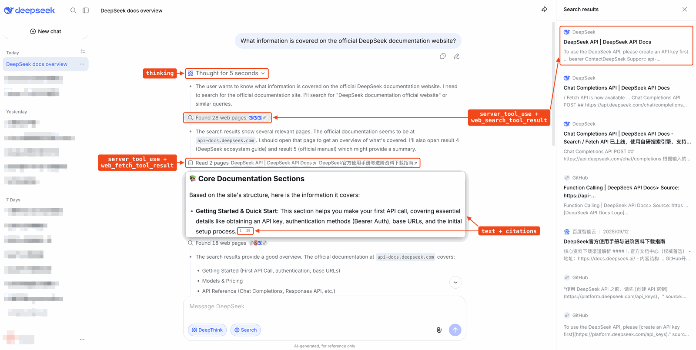

# AI Daily 2026-11-14

封面色：琥珀

## 今日一句话

> 新能力都停在人还能插手的地方：钱包要逐笔确认，眼镜只开预购，搜索和语音先标了价格。

## 今日要闻

### 1. OpenAI: ChatGPT Wallet 开始推送，结账仍要逐笔确认
- 来源链接：[OpenAI 发布稿](https://openai.com/index/introducing-chatgpt-wallet)
- 类型：产品更新
- 推荐指数：★★★★☆
- 一句话总结：ChatGPT Wallet 开始向美国 18 岁以上的 ChatGPT Pro 用户推送，dot 可以在用户逐笔确认后用卡组织签发的支付代币结账，真实卡号不交给 agent 或商家。

**为什么重要：** 用 ChatGPT 查商品、比选项、决定买什么，OpenAI 写成已经发生的事，并称每周有 12 亿人使用 ChatGPT。付款此前留在对话外面。11 月 12 日 Brave 把搜索 API 做成按次付费：agent 用 Base 上的 USDC 结算，不需要账号，LLM Context 以及网页、新闻、图片、视频和本地搜索都是每千次 5 美元。OpenAI 今天推的是另一条路，人的信用卡留在卡组织里，agent 拿到的是支付代币，而且每一笔都要用户再确认一次。

**核心观点：**
1. 首批是 ChatGPT Pro、18 岁及以上、人在美国、持有合格的美国发行银行卡。合作方写的是 American Express、Mastercard 和 Visa。用户添加一次卡，下单前核对商品、总额和所选的卡，再用面容识别或指纹这类安全校验通过。通过之后，支付网络签发一个带卡号、安全码和有效期的支付代币，记到所选的卡上；真实卡详情不分享给商家，也不分享给 agent。
2. 用户保留这张卡原有的积分，以及符合条件的争议保护，例如商品有缺陷。交易对象仍是商家，定价、履约、退货和客服由商家负责。OpenAI 称这是第一个让 agent 付款时接触不到真实卡号、并且每笔都要安全校验的钱包。
3. 同一篇发布稿给出面向商家的做法：认领 ChatGPT 里的商家资料并上传商品信息；用 Web Bot Auth 识别签名请求，避免防火墙误拦；与 Forter、Riskified、Sardine、Signifyd 以及 Adyen、Checkout.com、Stripe 一起，让风控认出 agent 发起的合法订单。按限额、品类或时间段把购买整段委托给 agent，发布稿写成以后的预期，不是今天的功能。

**这意味着什么：** agent 付钱在两天里分成了两种。Brave 解决的是没有账号也能按次买搜索；OpenAI 补的是在普通网站结账时，不必把真卡号交给模型或商家。零售这一层的授权仍在用户手上。接下来更可能卡住的是商家风控把合法订单拒掉，OpenAI 自己把「网站误拦、风控误拒」写成当前要一起解决的问题。完全不用人点头的委托购买，这篇稿没有说今天可用。

**风险与待验证：** 这是向美国 Pro 用户推送，不是全量开放。「第一个这样的钱包」是 OpenAI 的表述。每周 12 亿人同样来自这篇发布稿。网站仍可能拦截 agent，风控仍可能拒付。安全校验举的是面容识别或指纹这类例子，不是一份完整的设备清单。

### 2. Google: 智能眼镜开放预购，12 月 10 日开售
- 来源链接：[Google 预购稿](https://blog.google/innovation-and-ai/technology/xr-ar/google-intelligent-eyewear-collections-pre-order/)；[5 月 I/O 预告](https://blog.google/products-and-platforms/platforms/android/android-xr-io-2026/)；[Meta AI 眼镜商店页](https://www.meta.com/ai-glasses/)
- 类型：产品更新
- 推荐指数：★★★★☆
- 一句话总结：Google 与 Warby Parker、Gentle Monster、Samsung 合作的智能眼镜开始预购，Warby Parker 395 美元起，Gentle Monster 449 美元起，12 月 10 日在门店和线上开售。
- 配图：（图源：Google，不裁剪）
- 关键数字：$395 | Warby Parker 起售价

**为什么重要：** 带摄像头、能对话的眼镜已经在卖。Meta 的商店页目前列出 Ray-Ban Meta 和 Oakley Meta，写明有摄像头和可以对话的 AI，标价从 224 美元起。Google 自己在 5 月 19 日的 I/O 文章里预告过这条产品线：音频款今年秋天先上市，Gentle Monster 和 Warby Parker 的框型当时就点了名，但没有价格，也不能下单。今天预购打开，并给出 12 月 10 日这个开售日。

**核心观点：**
1. 合作设计方是 Warby Parker、Gentle Monster 和 Samsung。眼镜配合 Pixel、Samsung 手机和 iPhone。Gentle Monster 有六个设计，大多数框可以配处方镜片，在美国和韩国发售，449 美元起。Warby Parker 有 Alden、Reid、Wren 三款，分光学镜和太阳镜，395 美元起，超过 360 家门店可以预约演示。
2. 官方称镜框大约 41 克，电池最多 9 小时，充电盒最多再充 7 次。摄像头是 1200 万像素超广角。说 Hey Gemini，或点一下镜框，就能调用。Google 地图提供逐步导航；Google 翻译做实时语音翻译，自动检测语种，覆盖 70 多种语言。
3. 预购已经在 Gentle Monster 和 Warby Parker 的线上和店内开始，部分门店和 Google Store 可以上手试戴。12 月 10 日起在门店和线上开售。给 Gemini 用的摄像头画面不写入 Gemini 历史；官方称这些画面不用于训练模型或投放广告，并会先涂掉旁边人的脸。拍照或录像时有指示灯，灯被挡住或关掉就会停止录制。镜腿上有物理开关，可以把它当普通眼镜戴。

**这意味着什么：** 5 月的文章把智能眼镜分成先上市的音频款，和另一类会在镜片上显示信息的款。今天这篇预购稿写的是开耳扬声器、摄像头和语音里的 Gemini，没有写镜片上的屏幕，对上的是当时说的音频款。Google 补上的不是「眼镜里的助手」这个品类，而是价格、含 iPhone 在内的手机兼容，以及 12 月 10 日。Meta 的眼镜现在就能买。在 12 月 10 日之前，Google 这副是预购和店内演示。

**风险与待验证：** 重量和续航是官方的大约值和上限，正文没有把测试条件写在同一句里。Gentle Monster 写了美国和韩国；Warby Parker 的销售国家，这篇没有逐国列出。隐私是厂商的设计说明，没有独立审计。带显示的那一款不在今天的预购范围内。

### 3. DeepSeek: App 的搜索、文件和语音进入 API，并标出工具价
- 来源链接：[DeepSeek API 新闻](https://api-docs.deepseek.com/news/news261113)；[聊天应用指南](https://api-docs.deepseek.com/guides/build_a_chatbot)；[前端仓库](https://github.com/deepseek-ai/chat-demo)
- 类型：产品更新
- 推荐指数：★★★★☆
- 一句话总结：DeepSeek 把 App 里的搜索、读链接、文件、安全检查和语音做到 deepseek-flash 的 API 上，搜索和抓取各为每千次 0.75 美元，并放出一个不带后端的聊天前端。
- 配图：（图源：DeepSeek）
- 关键数字：$0.75 | 搜索或抓取，每千次

**为什么重要：** DeepSeek 的 App 里本来就有搜索、读链接和语音。开发者要在自己的产品里做同样的事，通常得另接这些服务。Brave 在 11 月 12 日把搜索 API 开放成按次付费，每千次 5 美元，卖的是 Brave 自己的索引。DeepSeek 今天挂上的不是另一个独立搜索引擎，而是 V4.1-Flash 上的一套工具：搜索和抓取各标价每千次 0.75 美元，工具费加在 token 费用之外。

**核心观点：**
1. 模型 ID 为 deepseek-flash，对应 V4.1-Flash。Messages、Responses 和 Chat Completions 都能用这些能力，工具调用和上下文组装在服务端完成。内置项包括：非思考模式下搜索网页或图片并带来源；思考模式下边推理边搜索、边读页面；把 PDF、Office 和图片解析进对话；自动读取用户消息里的链接；检查输入和输出，发现风险时返回拒绝标记。搜索、抓取、OCR、语音识别和语音合成也可以单独调用。
2. 发布页的价目图写着：搜索每千次 0.75 美元，抓取每千次 0.75 美元，OCR 每千页 0.225 美元。语音识别每小时 0.058 美元，划掉的价格是 0.116 美元，标注限时五折。语音合成每 1 万字符 0.225 美元，划掉的价格是 0.45 美元，同样是限时五折。
3. 面向公众的应用必须打开安全检查。开发者仍要自己负责内容审核、适用的模型备案，以及 AI 生成内容的标识。官方同时放出 deepseek-ai/chat-demo：浏览器直接调用 API，不需要应用后端，可以导入 DeepSeek 的对话历史。该仓库创建于 2026-11-12，许可证 MIT，2026-11-14 的 star 数为 686。

**这意味着什么：** 这是把已经在 App 里的能力收成一张开发者价目表，不是一款新的基础模型。Brave 卖的是按次结算的独立搜索；DeepSeek 卖的是挂在自家模型上的搜索、读页面和语音，公开应用还被要求打开安全检查。少写的是接入层。省不掉的是 token 费、语音折扣何时结束，以及打开网页搜索、读链接、高安全检查或标题之后，服务端会自行决定温度等参数，请求里的对应值不再生效。

**风险与待验证：** 工具价格来自发布页上的价目图，语音两行写明是限时折扣。安全检查被写成基本风控。搜索和语音的质量没有独立复测。价目图没有列出 token 本身的单价。上述能力写的是 deepseek-flash 这一款。

## 快讯

1. **xAI · Mac 版 Grok Bot 接入 7 类系统应用**：Mac 版 Grok Bot 现在可以调用信息、邮件、备忘录、提醒事项、日历、定位和通讯录。[来源](https://x.com/bot/status/2120946968403095906)
2. **OpenAI · dot 开始遵守自定义指令**：dot 现在可以遵守对话里写下的行为规则，包括哪些动作要先征得同意；官方同时称回复更快、术语更少。[来源](https://x.com/ChatGPT/status/2120970988796170275)
3. **Google · Gemini 接上 Google Wallet**：美国所有 Gemini 应用用户可以把 Google Wallet 接进 Personal Intelligence 查看支出；只能读取，不能转账或投资。[来源](https://blog.google/innovation-and-ai/products/gemini-app/google-wallet-gemini-app/)
4. **ggml · 发布 llama.cpp 1.0.0**：llama.cpp 与 ggml 发布 1.0.0，公开 C API 的破坏性变更此后才升主版本，同版加入 FP8 KV 缓存并支持 Kimi-K3.1-Pro。[来源](https://github.com/ggml-org/llama.cpp/releases/tag/v1.0.0)
5. **Google · Flow 上线 5 个创作者工具**：Google Flow 上线 5 个由创作者设计的工具，可让同一角色在不同年龄保持外观，也可把手机视频生成多个机位。[来源](https://blog.google/innovation-and-ai/models-and-research/google-labs/new-google-flow-tools/)

## 值得研究的开源项目

1. 项目名：deepseek-ai/chat-demo
   GitHub 链接：[deepseek-ai/chat-demo](https://github.com/deepseek-ai/chat-demo)
   Star 数：686（2026-11-14）
   解决什么问题：一个不带应用后端的静态聊天前端，浏览器直接调用 DeepSeek API，并可以导入已有对话。
   为什么值得看：今日要闻里第一次出现的仓库，创建于 2026-11-12。README 写明可以用 pnpm dev 在本地 8090 端口跑起来，也可以双击构建出的 index.html。许可证 MIT。
2. 项目名：alibaba/open-code-review
   GitHub 链接：[alibaba/open-code-review](https://github.com/alibaba/open-code-review)
   Star 数：50,608（2026-11-14）
   解决什么问题：在代码评审里同时跑确定性检查和 LLM agent，把意见落到具体行上。
   为什么值得看：规则覆盖空指针、线程安全、XSS 和 SQL 注入，模型接口兼容 OpenAI 与 Anthropic。今日 GitHub Trending。许可证 Apache-2.0。仓库创建于 2026-05-18，今天在榜。
3. 项目名：backnotprop/plannotator
   GitHub 链接：[backnotprop/plannotator](https://github.com/backnotprop/plannotator)
   Star 数：10,447（2026-11-14）
   解决什么问题：在计划、规格和 diff 上做批注，再把这些反馈一次送回 agent。
   为什么值得看：README 列出可接的编程工具包括 Claude Code、Codex、Copilot CLI 和 Gemini CLI，批注不用在聊天里重述一遍。今日 GitHub Trending。许可证 Apache-2.0。
