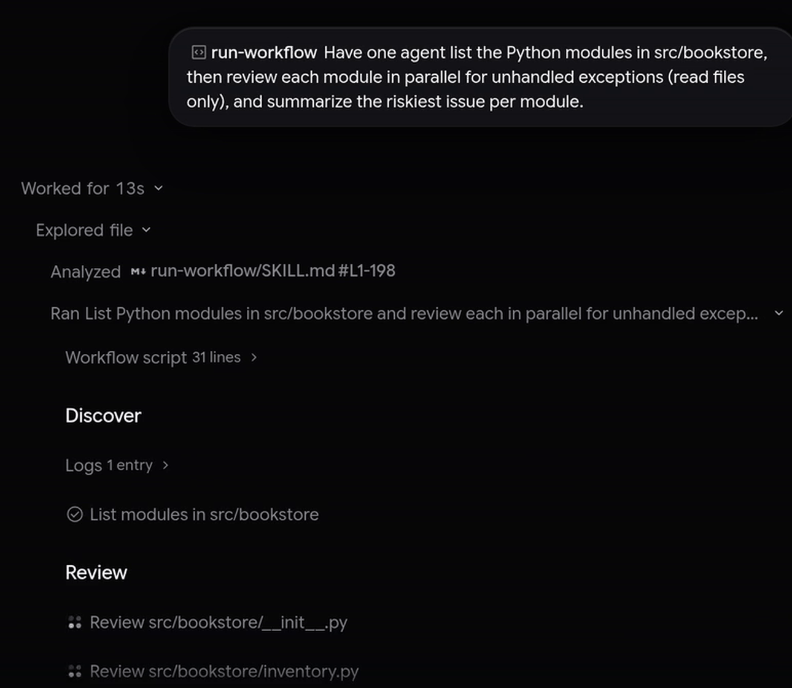

# AI Daily 2026-11-15

封面色：海蓝

## 今日一句话

> 个人 agent 进商家，开始有可实施的 1.0 协议；编程 agent 的分工，则从一段对话收成可审的脚本。

## 今日要闻

### 1. Sierra: 个人智能体协议 Poppy 发布 1.0，Shopify 全店默认打开
- 来源链接：[Sierra 博客](https://sierra.ai/blog/releasing-poppy)；[Muse 博客](https://muse.ai/blog/poppy-personal-agent-protocol)；[协议 1.0 规范](https://personalagentprotocol.org/docs/1.0/spec)；[企业实施套件](https://personalagentprotocol.org/kit/company)
- 类型：行业
- 推荐指数：★★★★☆
- 一句话总结：Sierra 发布个人智能体协议 Poppy 1.0，商家用一个 poppy.json 告诉个人 agent 自己提供什么；Sierra 称 Shopify 全店默认发布该文件，Meta 的 Muse 已经支持。
- 关键数字：100+ | 设计伙伴；Shopify 全店默认发布

**为什么重要：** 个人 agent 替人订票、查订单、退货，卡在商家门口。网站分不清「客户的 agent」和「乱爬的机器人」，常常两个一起拦。已有的标准各管一段：MCP 管 agent 怎么调用开发者配好的工具，OpenAPI 管现成的 HTTP 接口，Shopify 的通用商务协议 UCP 管找商品、加购和结账。缺的是更前面的一步：agent 到了任意一家店，如何表明身份，并读到自己被允许做什么。Sierra 写道，这份协议上个月已与 Meta、Genesys、Instinct、NiCE、Rocket、Shopify、Stripe、Walmart 等设计伙伴公布草案，过去五周对着真实网站和 API 改过；今天是 1.0。

**核心观点：**
1. 商家发布一个 poppy.json，写明可以通过网站、已有 API、MCP 服务器或商家自己的 agent 到达。只做网站的店可以先发这个文件，不必先上客户登录。身份验证用 OAuth，客户可以管理 agent 的权限。协议允许分阶段接入，行业扩展不改核心；Shopify 与 Sierra 共同撰写了商务扩展，把 Poppy 和 UCP 接上。
2. Sierra 称，每家 Shopify 商店本来就默认支持 UCP，现在也会自动发布 Poppy 文件，商家不用额外实现。UCP 负责购物本身，Poppy 负责 agent 进门、自报身份、确认权限。商务扩展让 agent 可以访客购物或用客户账号登录，并在部分动作前先问客户；也接到 UCP Ask，让购物 agent 能直接和店里的 agent 对话。Sierra 写 Shopify 的业务覆盖 175 个以上的国家。
3. Sierra 称 Poppy 已经对所有 Muse 用户打开，Muse 访问网站时会先找 Poppy；Muse 自己的文章说，它是第一个支持该协议的个人 agent，任何企业今天就可以实现。设计伙伴新增 60 家，总数超过 100 家。Sierra 称 Mercury 和 Turkish Airlines 已经可以让个人 agent 办理业务；Synchrony 在同一节写的是将会把分期和奖励带进 agent 购物。

**这意味着什么：** 这条线里，MCP 先解决「agent 调用谁配好的工具」，UCP 再解决「购物动作本身」，Poppy 补的是进门和授权。1.0 加上 Shopify 默认发布，意味着个人 agent 不必再为每家店单独做爬虫式对接。接下来更可能卡住的不是文件在不在，而是商家愿不愿意让 agent 真的下单或转账：协议把「某些动作前先问客户」写进了扩展，但每家店的审批策略仍然在店自己手里。其他个人 agent 若要进同一批店，读的会是同一份 poppy.json，而不是再各写一套。

**风险与待验证：** 「全店默认发布」「Muse 会先找 Poppy」「超过 100 家设计伙伴」都来自 Sierra 的发布稿，这篇稿没有在 Shopify 的文档里另行核对。Muse 的文章确认自己支持 1.0，没有复述「每个网站都先找 Poppy」。已上线伙伴的具体能力（查余额、订票）是各家场景，不是协议保证今天都能完成支付。规范以 personalagentprotocol.org 上的 1.0 文本为准。

### 2. Google: Antigravity 上线 Dynamic Workflows，用 Python 脚本调度子 agent
- 来源链接：[Dynamic Workflows 文档](https://antigravity.google/docs/dynamic-workflows)；[更新日志](https://antigravity.google/docs/changelog)；[11 月 11 日 /swarm 文档](https://antigravity.google/docs/swarm)；[8 月 27 日 /teamwork 博文](https://antigravity.google/blog/teamwork-when-ai-becomes-a-research-partner)
- 类型：产品更新
- 推荐指数：★★★★☆
- 一句话总结：Google Antigravity 在 App 和 CLI 中上线 /run-workflow，agent 编写并运行一段 Python，用并行或顺序阶段调度多个子 agent；文档写明面向 Google AI Pro 和 Ultra。
- 配图：（图源：Google）

**为什么重要：** 编程 agent 的分工已经有好几套，但控制流大多还在对话里。11 月 11 日 Antigravity 预览 /swarm：当前对话当协调者，多个 worker 在共享留言板上协作。11 月 12 日的更新日志把 Orchestrator 和 Gemini 4 Hydrogen 放在一起：一个对话里由 Gemini 4 Carbon 或 Argon 规划和审查，日常工具调用交给 Hydrogen。8 月 27 日的 /teamwork 则是带范围访谈的多人协作团队。这些都靠模型在上下文里维持顺序。Dynamic Workflows 把顺序写成代码：agent 按任务写一段短 Python，用 parallel() 并发、用 pipeline() 串行，子 agent 按 JSON Schema 交回结果，文件读取和测试日志不进主对话。

**核心观点：**
1. 命令是 /run-workflow。文档写明，App 与 CLI 上的 Google AI Pro 和 Google AI Ultra 可以使用。更新日志把这项功能记在 Antigravity App v2.32.0，日期为 2026 年 11 月 13 日。运行时自带 Python，用户不必另外安装。
2. 脚本在独立进程里跑。除非权限预设已经允许，否则每一份脚本在运行前都要用户批准；批准只覆盖这份脚本本身，不能用命令前缀规则笼统放行。工作流拉起的每个 agent 仍按用户的权限预设，在自己的对话里另行请示。
3. 文档把几种分法写在一张表里：Orchestrator 是单对话里的规划与执行分工，子 agent 适合交出去一件事，/swarm 适合 agent 之间要互相看 diff、对齐接口，/teamwork 适合有范围访谈的多里程碑项目。需要 agent 边做边互相协调时，文档写明用 /swarm，而不是 workflow。

**这意味着什么：** /swarm 解决的是「几个 agent 在一块留言板上商量」，Orchestrator 解决的是「一个对话里谁规划、谁动手」。/run-workflow 补的是第三种：同一项检查要扫过很多文件，或先写失败测试再修，控制流应该是一段可审的脚本，而不是越来越长的对话。文档自己把边界画清了，说明 Google 不打算用一种编排吃掉另一种。其他编程 agent 若跟进，下一步更可能是「计划以代码形式给人看过再跑」，而不只是再加一个多 agent 开关。

**风险与待验证：** 更新日志把功能记在 11 月 13 日的 v2.32.0，文档写明 Pro 与 Ultra 可用，但没有写明每个安装包同一时刻收到。并行拉起的 agent 各自请示权限，一次扇出可能变成多次确认。没有独立测试说明脚本编排比 /swarm 更少跑偏。

## 快讯

1. **Google · 称 /teamwork 可对外部使用并开放学术名额**：Google Research 11 月 13 日发文，称外部开发者可以在 Antigravity 和 Deep Review 里使用 /teamwork 与 /boost，并开放 1 万个学术名额申请 6 个月最高用量。该命令的产品博文日期是 8 月 27 日，不是今天才有的功能；文中的证明和代码移植结果是 Google 自述，正式证明模式写的是即将提供。[来源](https://research.google/blog/advancing-science-engineering-with-antigravitys-teamwork-feature/)
2. **Anthropic · Claude Code 的 Projects 改为对话式协调**：产品页称，用户随时说出需求，Claude 会接住、协调各线程并随时汇报。这是 Claude Code 里的新能力，也是聊天和 Cowork 中已有 Projects 的升级，分阶段推出，可以加入候补。企业版写明 11 月 20 日起默认开启，启用 HIPAA 或全组织零数据保留的不在默认范围内。[来源](https://claude.com/form/projects)
3. **NVIDIA · 用两台 DGX Station 跑 GLM-5.3**：NVIDIA 这篇教程用 vLLM 张量并行，把 GLM-5.3 NVFP4 放在两台 DGX Station 上。正文写该量化模型总参数 753B、每 token 激活约 40B，权重大约 464 GB，超过单块 GB300 的 252 GB HBM3e。SPEED-Bench Coding 开启前缀缓存时，并发 16 的总输出为 607.8 token/秒，并发 32 降到 385.0 token/秒。[来源](https://developer.nvidia.com/blog/when-one-gpu-isnt-enough-serving-glm-5-3-across-two-nvidia-dgx-stations-with-vllm/)

## 值得研究的开源项目

1. 项目名：ashhart/TensorFold
   GitHub 链接：[ashhart/TensorFold](https://github.com/ashhart/TensorFold)
   Star 数：2,160（2026-11-15）
   解决什么问题：用一个 Zig 二进制在 Apple Silicon 和 NVIDIA GPU 上提供语言模型推理，不需要安装 Python 或 MLX。
   为什么值得看：README 把贡献流程收成 Agent Traffic Control：先 atc check 再 atc claim，避免人和 agent 抢同一个 issue。今日 GitHub Trending。仓库创建于 2026-06-19。许可证 Apache-2.0。
2. 项目名：Tencent/LoopForge
   GitHub 链接：[Tencent/LoopForge](https://github.com/Tencent/LoopForge)
   Star 数：903（2026-11-15）
   解决什么问题：自托管的编程 agent 交付流程，在沙箱工作区里编排 CodeBuddy、Codex 和 Claude Code，合并前由人批准。
   为什么值得看：README 把「可重复的操作步骤」和「人点头才发布」放在同一条路径上，适合看多 agent 交付怎么留审批门。今日 GitHub Trending。仓库创建于 2026-07-28。LICENSE 写明主体为 MIT，第三方组件沿用各自原许可证。
3. 项目名：dream-num/univer
   GitHub 链接：[dream-num/univer](https://github.com/dream-num/univer)
   Star 数：24,486（2026-11-15）
   解决什么问题：把表格和文档编辑嵌进自己的产品，再接上应用或 agent。
   为什么值得看：README 的起点是开源的 Sheets 和 Docs，agent 面对的是可嵌入的办公界面，而不是再导出一份静态文件。今日 GitHub Trending。仓库创建于 2022-09-29，今天在榜。许可证 Apache-2.0。
