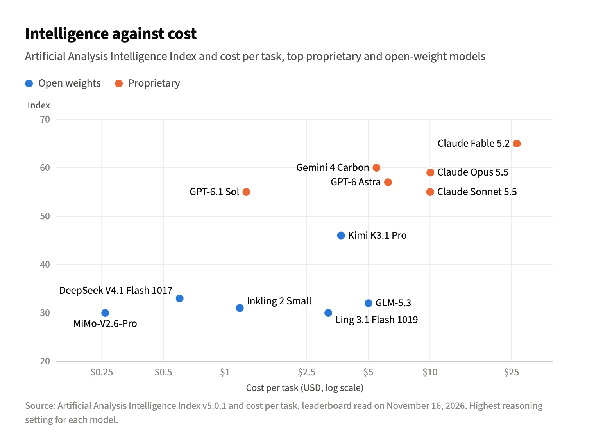

# AI Daily 2026-11-17

封面色：琥珀

## 今日一句话

> Qwen4-Max 公布 71B 激活和更低标价；Hub 上的语言模型推理改走 OpenRouter。

## 今日要闻

### 1. 阿里: Qwen4-Max 正式上线，激活参数少于上一代且标价更低
- 来源链接：[发布博客](https://qwen.ai/blog?id=qwen4-max)；[模型文档](https://platform.qianwenai.com/docs/developer-guides/getting-started/latest-model)；[千问平台计费](https://platform.qianwenai.com/docs/developer-guides/getting-started/pricing)；[百炼价目](https://www.alibabacloud.com/help/zh/model-studio/model-pricing)
- 类型：模型发布
- 推荐指数：★★★★★
- 一句话总结：11 月 11 日只在 Token Plan 预览的 Qwen4-Max，今天以模型 ID qwen4-max 正式开放；博客写 2.4T 主干、每 token 激活 71B，百炼新加坡标价低于同页的 Qwen3.8-Max。
- 关键数字：71B | 每 token 激活，主干仍是 2.4T

**为什么重要：** 11 月 11 日的预览没有公开参数、上下文和目录价。今天的博客写出架构：Qwen4 主干 2.4T，每 token 激活 71B，另有 328B 的 N-gram Embedding，这 328B 不计入 71B。博客写，相对 Qwen3.8-Max-Base，激活参数大约少 25%，总规模仍是 2.4T。百炼帮助页的更新时间是 2026-11-16。新加坡地域的 qwen4-max 不按输入长度分档，每百万 token 输入 1.50 美元、输出 4.50 美元；同一张表上的 qwen3.8-max 是 2 美元和 6 美元。千问平台计费说明写的是北京部署、人民币：输入 10 元、输出 30 元，思考与非思考同价。两张表不是汇率换算。

**核心观点：**
1. 模型文档写，上下文 1,000,000 token；非思考模式最大输出 131,072，思考与最终回答合计上限 262,144，默认思考预算 131,072。输入包括文本、图像和视频，能力表还列了 PDF。思考强度是 low、high、xhigh，默认 high。这张能力表写批量推理不支持，也不支持调优和部署。按量付费写有 100 万 token 免费额度，与 Token Plan 的 Credits 分开。
2. 博客说缓存输入的降幅尤其大，但没有给出 Qwen3.8-Max 的旧缓存单价。Qwen4 自己的单价可以核对：千问平台上，显式或隐式缓存读取是 0.5 元，5 分钟显式缓存创建 12.5 元，1 小时 20 元，单位都是每百万 token。百炼新加坡对应 0.075 美元、1.875 美元和 3 美元。文档写，隐式缓存不保证命中；新的显式缓存支持 Chat Completions、Responses 和 Anthropic Messages，DashScope 不支持。
3. Work360 是阿里自建的行业任务集，博客写它覆盖 26 个一级领域、182 个二级子域、721 个专业领域。同一页写 Qwen4-Max 得分 52.69，Qwen3.8-Max 是 47.74。token 用量在 Work360 上大约少 24%（Xhigh）和 35%（High）；下一分句写 Terminal-Bench 4.0 大约少 48% 和 49%，按前半句的顺序对应 Xhigh 和 High。Work360 单任务成本从 4.43 美元到 1.67 美元，博客称为降低 62%。这些是厂商自测。Max 的权重没有开放；博客写更小的 Qwen4 会开源。Token Plan 更新日志把 2026-11-16 记成正式上线，11 月 11 日那条预览折扣没有写进正式上线这一条。

**这意味着什么：** 对照物是同一 2.4T 规模的 Qwen3.8-Max。博客把激活参数的降幅写在 Qwen3.8-Max-Base 上，大约少 25%；百炼新加坡表把目录价写在在售的 qwen3.8-max 上，从每百万 token 输入 2 美元、输出 6 美元，改为 1.50 美元和 4.50 美元。11 月 11 日 Qwen4-Max 只以预览身份进了 Token Plan。今天补上的是正式模型 ID、激活参数、上下文和这张更低的目录价。Google 在 11 月 12 日把 Gemini 4 拆成旗舰 Carbon 和效率档 Hydrogen，两档分开卖。阿里这次是把 Max 这一档原地换掉，权重仍不公开。调用方现在能对上的是价格和上下文。少花钱是否成立，要看 Work360 以外的复测，以及缓存是否命中。

**风险与待验证：** Work360 分数、token 降幅和 62% 的成本都来自发布博客，没有独立复测。工件编程从大约 475 分钟到 24 分钟，是博客里的展示案例，不是普遍结果。百炼华北 2（北京）一行是 1.413 美元和 4.24 美元，与新加坡的 1.50 美元、4.50 美元不同，也与千问平台的 10 元、30 元不同，下单以控制台地域为准。预览期 Credits 折扣写到 11 月 25 日 24:00（UTC+8），正式版是否沿用，更新日志没有写。能力表写批量推理不支持，模型市场页仍列出批量任务，两页不一致。

### 2. Hugging Face: 语言模型推理改走 OpenRouter，自带供应商密钥不再用于文本
- 来源链接：[Hugging Face 博客](https://huggingface.co/blog/openrouter)；[OpenRouter 公告](https://openrouter.ai/blog/announcements/hugging-face-inference-providers/)
- 类型：产品更新
- 推荐指数：★★★★★
- 一句话总结：Hugging Face 把 Inference Providers 的语言模型路由换成 OpenRouter，原有代码和 token 继续可用；文本模型不能再自带供应商密钥。
- 配图：（图源：Hugging Face）
- 关键数字：71.7% | 9 月底占 OpenRouter 的 token

**为什么重要：** 原先一次请求选定一个供应商，失败就返回该供应商的错误。现在语言模型请求经 OpenRouter，按实时价格、速度和可靠性选择，失败时在同一次调用里改走下一家。图像、视频和音频仍直接走 Hugging Face，不经过 OpenRouter。OpenRouter 写，10 月重建路由的现场实验里，容量错误少 46%，首 token 时间快 16.9%，吞吐高 16.3%，单次请求成本高 6.0%。Hugging Face 的文章引用了前三项，没有写这 6.0%。

**核心观点：**
1. 模型 ID 可以加后缀：`:fastest`、`:cheapest`，或供应商名。对话留在持有其提示缓存的供应商上；要固定会话，请求头使用 `X-HF-Session-Id`。设置里可以关掉某个供应商。Hugging Face 写，定价不变，不在供应商价格上加价；PRO 每月 2 美元额度，Team 和 Enterprise 每席 2 美元。文本模型不再接受调用方自己的供应商密钥；图像和视频的自定义密钥仍然有效。
2. Hugging Face 援引 OpenRouter 2026 年 10 月的统计：开放权重占所服务 token 的比例，从 2025 年 10 月的 26.8% 到 2026 年 9 月底的 71.7%，7 月曾到 77.5%。同一段写，本周用量最高的模型是 DeepSeek V4.1 Flash 1017，59.2 万亿 token。开放权重的平均价格大约是每百万 token 输入 0.28 美元、输出 1.62 美元，闭源是 1.27 美元和 6.36 美元。配图上，Kimi K3.1 Pro 的智力指数是 46，Claude Fable 5.2 是 65，单任务成本是 3.68 美元对 26.54 美元。图注写明，这是 Artificial Analysis 智力指数 v5.0.1，2026-11-16 读取，每个模型用最高推理档。
3. OpenRouter 的公告写，今天经这条集成可调用 160 个模型、来自 38 家实验室，也就是 Hub 上有页面、并且 OpenRouter 在提供的那些模型。公告还写，可以把每次请求的轨迹发到调用方自己的 Hugging Face Storage Bucket，目前是测试版；文件包含输入、输出、token 数和费用，不含图像等媒体。Hugging Face 把「连接 OpenRouter 账号」和「把更多任务改走 OpenRouter」写成下一步，没有把轨迹写成默认已经打开。

**这意味着什么：** 多供应商路由本来就是 OpenRouter 在做的事。Hugging Face 写道，OpenRouter 每月处理超过 800 万亿 token，覆盖 600 多个模型、80 多家供应商。Hub 原先自己维护一套路由器，权重页和调用是两层。今天聊天模型的默认调用并进了那一层，账单仍记在 Hugging Face 账号。受影响的是给语言模型填写自己供应商密钥的调用：文本这条路径关掉了，图像和视频还在。开放权重已经占这条路由上的多数 token，Hub 上的默认按钮跟着用量走。调用方仍可用后缀或关闭供应商来限制去向，但失败重试不再停在第一家。

**风险与待验证：** 46%、16.9%、16.3% 和 6.0% 是 OpenRouter 在 10 月的实验，不是 Hugging Face 今天新测的。智力指数和单任务成本来自 Artificial Analysis，由 Hugging Face 制图，不是本报复跑。71.7% 是 9 月底的口径；OpenRouter 公告另写，10 月付费 token 里开放权重大约 70%，两个数字不要合成一个。所谓更好的供应商，指的是价格、速度和可靠性的组合，不是效果排名。

### 3. Google: Ask Maps 生成可分享行程，预约查找先在美国上线
- 来源链接：[Ask Maps 更新](https://blog.google/products-and-platforms/products/maps/ask-maps-holiday-travel-features-2026/)；[2026-03-12 上线说明](https://blog.google/products-and-platforms/products/maps/ask-maps-immersive-navigation/)；[TechCrunch](https://techcrunch.com/2026/11/16/google-maps-can-now-build-trip-itineraries-with-real-time-details-about-each-stop/)
- 类型：产品更新
- 推荐指数：★★★★★
- 一句话总结：Ask Maps 从今天起在 Android 和 iOS 上推送按天行程，可分享，桌面端可导出到 Google Docs；查找预约和出发前提示先在美国上线。
- 关键数字：30 国 | 欧洲扩区；行程跟到已开通地区

**为什么重要：** Ask Maps 在 2026 年 3 月 12 日先在美国和印度上线，当时是用一句话问地点，再在地图上给出建议。今天多出来的是一份可以再次打开的行程：按天安排、编号图钉、可分享，桌面端可导出到 Google Docs。出发时能看实时路况和是否营业，也可以加停靠点再导航。美国区另外可以查找美容、宠物、汽修和家修的可预约时段；官方博客写，也可以让它给本地商家打电话。

**核心观点：**
1. 行程和清单搜索提供给所有已经开通 Ask Maps 的地区。出发前提示和查找预约先在美国，其他地区写的是稍后。
2. 同一天 Ask Maps 开始扩到欧洲 30 个国家，博客点名西班牙、德国和英国，并写这样就覆盖 200 多个国家和地区。推送从今天开始，不是所有设备同时打开。
3. 清单搜索的官方例子，是询问已保存地点里哪些在 30 分钟内能坐 5 个人。预约的例子是附近下午 4 点的美甲。这两句是产品说明里的例子，博客没有给出成功率。

**这意味着什么：** 3 月的 Ask Maps 停在一句回答和一张地图。今天同一入口开始留下可再次打开的行程；美国区再往前一步，去查可预约时段。这和在聊天窗口里列一份文字行程不同：图钉、营业状态和导航仍在 Maps 里。接下来更值得看的是预约查找会不会离开美国。行程已经绑在 Ask Maps 开通的地区上，预约查找还绑在美国。

**风险与待验证：** 「开始推送」不等于今天每个账号都能用。给商家打电话，以及博客写的「下一家是什么氛围」，都没有公布成功率。功能赶在节日档期发布，地区划分仍是上面这两档。没有独立复测。

## 快讯

1. **OpenAI · 医疗版开放计算机使用 agent**：ChatGPT for Healthcare 今天可用该 agent，并上线 20 余个插件；超过 1300 次医师盲评里，更新后的临床检索在 8 个维度上都更高。[来源](https://openai.com/index/more-ways-to-move-care-forward-with-chatgpt-for-healthcare)
2. **Google · Gemini Notebook 能把来源做成交互网页**：18 岁以上用户在网页端输入 make me a site，即可生成并分享；Workspace 订阅包含在内，移动端尚未上线。[来源](https://blog.google/innovation-and-ai/products/gemini-notebook/interactive-sites/)
3. **Google · Gemini 应用增加 66 种地区语音**：Android 与 iOS 开始推送，选定声音贯穿 Gemini Live 和对话朗读，包含美式英语、印地语和韩语等。[来源](https://blog.google/innovation-and-ai/products/gemini-app/regional-voices/)
4. **OpenAI · 向受审核机构提供 CSAM 图像分类器**：新分类器经 API 向通过审核的机构免费开放，并可标出疑似由 AI 生成的材料。官方估计标记图片约少 48%，检出的虐待图像数量大致持平。[来源](https://openai.com/index/strengthening-online-child-safety)

## 值得研究的开源项目

1. 项目名：ag-ui-protocol/ag-ui
   GitHub 链接：[ag-ui-protocol/ag-ui](https://github.com/ag-ui-protocol/ag-ui)
   Star 数：18,944（2026-11-17）
   解决什么问题：用一套双向事件流，把 agent 的输出接到网页、手机、终端或 Slack，而不是每个框架各写一套。
   为什么值得看：README 写，AG-UI 1.0 的规格已经冻结，TypeScript、Python 和 .NET 的 SDK 由 JSON Schema 生成，0.x 与 1.0 双向兼容。今天 GitHub Trending。仓库创建于 2025-05-07，不是新仓库。许可证 MIT。
2. 项目名：kajisho5/ffmpeg-skill
   GitHub 链接：[kajisho5/ffmpeg-skill](https://github.com/kajisho5/ffmpeg-skill)
   Star 数：6,682（2026-11-17）
   解决什么问题：让编程 agent 在本机用 FFmpeg 剪视频、加字幕、导出，再检查成片，不把素材传到云端。
   为什么值得看：README 的入口是 `npx ffmpeg-skill`，不需要模型 API 密钥。仓库描述写有 42 个 FFmpeg 工具，并带 MCP。今天 GitHub Trending。仓库创建于 2026-09-03。许可证 MIT。
3. 项目名：google-research/paper-orchestra
   GitHub 链接：[google-research/paper-orchestra](https://github.com/google-research/paper-orchestra)
   Star 数：1,482（2026-11-17）
   解决什么问题：把提纲、文献、分节写作、修改和作图拆给不同 agent，把笔记和实验记录收成 LaTeX 稿。
   为什么值得看：README 把流水线写成可单独替换的角色，模型密钥由调用方自己提供，Gemini 或 OpenAI 都可以接。今天 GitHub Trending。仓库创建于 2026-05-01，最近一次推送是 2026-11-15。许可证 Apache-2.0。
