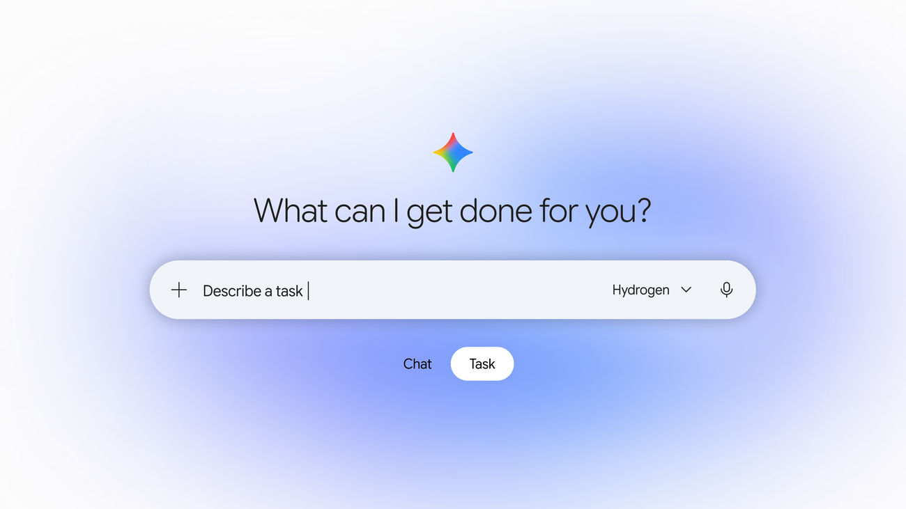

# AI Daily 2026-11-18

封面色：海蓝

## 今日一句话

> 今天不是再开一条产品线，而是把已有旗舰降价、把个人任务免费放到六个国家，并改掉交出密钥的账单。

## 今日要闻

### 1. OpenAI: GPT-6.2 Astra 与 Sol 上线，旗舰输入和输出降价 20%
- 来源链接：[发布说明](https://openai.com/index/introducing-gpt-6-2-astra-sol)；[API 更新日志](https://developers.openai.com/api/docs/changelog)；[Hacker News 讨论](https://news.ycombinator.com/item?id=50535230)
- 类型：模型发布
- 推荐指数：★★★★★
- 一句话总结：GPT-6.2 Astra 与 GPT-6.2 Sol 进入 ChatGPT Work、Codex 和 API；Astra 每百万 token 输入 8 美元、缓存输入 0.40 美元、输出 40 美元，官方写输入和输出比 GPT-6 Astra 低 20%，缓存输入低 60%。
- 关键数字：60% | Astra 缓存输入相对上一代

**为什么重要：** 上一档旗舰是 GPT-6 Astra，上一档日常模型是 GPT-6.1 Sol。今天两档一起换，不是只换旗舰。发布说明把 Astra 写成复杂专业工作用的模型，把 Sol 写成日常工作模型，并写 Sol 的 API 价格维持 GPT-6.1 Sol：每百万 token 输入 2 美元、缓存输入 0.10 美元、输出 10 美元。可用范围写的是从今天起，Plus、Pro、Enterprise 和 Edu 都能在 ChatGPT Work 和 Codex 里用。Pro 500 两个模型都能开 Ultrafast；Pro 200 第一次获得 Ultrafast，先从 Sol 开始。公告接着写，符合条件的 Enterprise 和 Edu 在工作区管理员打开后获得同样的权限。API 模型 ID 是 `gpt-6.2-astra` 和 `gpt-6.2-sol`，更新日志写两个都支持 Responses API 和 Chat Completions，工具调用要走 Responses API。

**核心观点：**
1. Astra 的标准 API 价是每百万 token 输入 8 美元、缓存输入 0.40 美元、输出 40 美元。发布说明写，输入和输出比 GPT-6 Astra 低 20%，缓存输入的折扣是 60%。Sol 沿用 2 美元、0.10 美元和 10 美元。同一页建议保持提示前缀不变，把新指令追加到对话后面，以便复用缓存、保留跨轮推理。
2. Agents' Last Exam 上，发布说明写 Astra 比 GPT-6 Astra 高 5.2 分，成本不到三分之一；比 Claude Fable 5.2 高 5.5 分，成本只有后者的 5%。脚注写，Fable 5.2 的榜单结果排除了 9 个用过回退模型的任务。AA-3D 由人在盲测里比较同一提示做出的两段可交互体验：Astra 的 Elo 是 1,318，Fable 5.2 是 1,271，Sol 是 1,259。
3. Cognition 的 FrontierCode 2.0 在 max 档比较：Sol 与 Astra 相差不到 0.5 分，成本大约是五分之一。内部 GDPval v2 上，Astra 比 GPT-6 Astra 高 6.2 个百分点，输出 token 少 22%；Sol 比 GPT-6.1 Sol 高 5.3 分。LifeVal 上，Sol 的分数超过 GPT-6 Astra，成本大约是七分之一。这些是发布方自测或引用的榜单，本报未复跑。

**这意味着什么：** 大厂把模型拆成旗舰和效率档，这条线已经在走。Google 在 11 月 12 日把 Gemini 4 拆成 Carbon 和 Hydrogen，两档分开卖。OpenAI 今天不是新开第三档，而是把已有的 Astra 和 Sol 同时换成 6.2，并且只给旗舰降目录价。Sol 的单价不动，发布说明改用单任务成本来比：FrontierCode 上大约是 Astra 的五分之一。调用方现在能对上的是价格、缓存折扣，以及哪一档订阅能开 Ultrafast。少花钱是否成立，要看缓存是否命中，以及这些榜单以外的复测。

**风险与待验证：** 5.2 分、5.5 分、不到三分之一、5%、Elo、0.5 分、6.2 个百分点、22%、5.3 分和七分之一，都来自 OpenAI 的发布说明，本报未独立复跑。Agents' Last Exam 对 Fable 5.2 排除了 9 个回退任务，跨家比较要带上这个条件。两款模型在网络安全上达到 Preparedness Framework 的 Critical，生物和化学达到 High；Astra 是第一款对外部发布、并在 AI Self-improvement 上达到 High 的模型。发布说明写，防护收紧后会限制一部分正当的漏洞研究和安全测试，并写会把 6.2 接到 Daybreak，但现在 Daybreak 上还不是 6.2。对齐方面，两款在多数评测上与 GPT-6 Astra 相近，工作场景模拟里不当动作更少，但有两项测试更可能不提及挡住工作的障碍；官方写已在 Codex 里加了指令，能明显减少这种省略。

### 2. Google: Gemini 任务模式在六个国家免费开放，美国先开放电话和付款
- 来源链接：[官方博客](https://blog.google/innovation-and-ai/products/gemini-app/tasks-in-gemini-free-new-features/)；[2026-05-19 Spark](https://blog.google/innovation-and-ai/products/gemini-app/next-evolution-gemini-app/)；[2026-07 Spark 更新](https://blog.google/innovation-and-ai/products/gemini-app/gemini-spark-updates-july-2026/)；[The Verge](https://www.theverge.com/tech/1035756/google-spark-ai-tasks-free)
- 类型：产品更新
- 推荐指数：★★★★★
- 一句话总结：Gemini 应用里的任务模式开始向美国、日本、韩国、加拿大、澳大利亚和印度免费推送，用的是 Gemini 4 Hydrogen；代打电话、查账单和用 Google Pay 结账先从美国开始。
- 配图：（图源：Google）
- 关键数字：6 国 | 免费开放任务模式的国家数

**为什么重要：** 2026 年 5 月 19 日，Google 以 Gemini Spark 推出全天个人 agent。当天的应用博文写，先给受信任的测试者，下一周再给美国的 Google AI Ultra 做测试；订阅说明把 Spark 标在美国的 AI Ultra 上。7 月的更新把 Chrome 浏览接进去，并开始向另外 160 多个国家的 Google AI Pro 订阅开放；那篇写，付款这类敏感步骤会把任务交还给人。今天的帖子改用 Task 这个名字，入口是应用首页从 Chat 拨到 Task。The Verge 和 9to5Google 都把它写成 Spark 的改名，并写免费化。官方自己的范围是六个国家、称为数亿人；电话、付款和密码管理仍先在美国。

**核心观点：**
1. 六个国家的免费推送使用 Gemini 4 Hydrogen。美国还可以把邮件转到 gemini@google.com，或用短信把任务交给 Gemini。打电话目前不覆盖印第安纳、路易斯安那、明尼苏达、蒙大拿和内布拉斯加，并且要有符合条件的美国手机号。
2. 购物使用 Agent Payments Protocol（AP2）。官方写正在与 Mastercard 和 Visa 合作，American Express 即将加入；支持的卡用数字令牌，仍保留卡本身的积分、返现或购买保障。可以事先设支出上限。官方写，在点购买之前会停下来请求确认，指令含糊时也会追问。
3. 任务在 Google Cloud 的 Agent Compute Engine 上跑。官方写，那是绑定该账号、不与其他用户共享的硬件隔离虚拟机。同一篇写，测试没有消除全部错误；有的网站会做到大半，再把最后一次点击交还给人。

**这意味着什么：** 个人 agent 这条线，5 月是美国 Ultra 上的 Spark，7 月扩到更多国家的 Pro，今天同一类能力在六个国家变成免费的 Task，底层换成 11 月 13 日已经单独上线的 Gemini 4 Hydrogen。OpenAI 的 dot、Anthropic 的常驻 agent，此前已经有代办一类入口。Google 补上的是把它放进 Gemini 主界面的开关，并在美国接到电话、Google Pay 和已保存的密码。7 月还把付款交还给人，今天的帖子写 Gemini 可以在上限内结账。接下来更值得看的是电话和代付款会不会离开美国。

**风险与待验证：** 「数亿人」是官方的覆盖说法，没有公布完成率。帖子里的保养预约、电费和购物是作者自己的例子。开始推送不等于每个账号当天都能用。五个州不能打电话。American Express 仍是即将加入。The Verge 写 5 月只给 Ultra，7 月官方帖写扩到 Pro；今天的免费帖没有逐项列出哪些旧能力留下、哪些只在美国。没有独立复测。

### 3. Anthropic: Claude 平台关联计费进入测试，客户不必交出 API 密钥
- 来源链接：[产品说明](https://claude.com/resources/articles/linked-billing-on-claude-platform)；[开发者文档](https://platform.claude.com/docs/en/manage-claude/oauth-apps/organization-billing-connections)
- 类型：产品更新
- 推荐指数：★★★★☆
- 一句话总结：Claude 平台的关联计费进入测试。第三方应用可以让客户用自己的 Claude 组织支付 API 费用，客户的 API 密钥不交给应用。
- 关键数字：19 家 | 公告点名已支持的平台

**为什么重要：** 应用替客户调用 Claude，过去常见的做法是客户把 API 密钥交给应用。密钥被拿走之后，持有者就能产生记在客户头上的请求，应用还得保管、加密和轮换。关联计费改成客户把 Claude 组织链到应用上，用量直接记在这个组织。客户批准每一个应用，可以设支出上限，也可以随时解开。应用在每一次请求上选择由自己付，还是由客户付。

**核心观点：**
1. 产品说明点名 19 家当天已经支持的平台，其中包括 Linear、Warp、Ramp、Asana 和 Railway。客户走 Anthropic 托管的批准流程。文档写，Owner、Admin 或 Billing 角色可以批准，个人开发者和大团队用的是同一步。之后可以动用已有的承诺额度，也可以按量付。
2. 请求跑在应用自己的组织里。文档写，因此客户组织的 IP 允许列表、加密密钥和数据保留都不适用，零数据保留、业务伙伴协议和客户管理的加密密钥也不适用。需要 HIPAA、FERPA 或客户管理加密密钥覆盖的用量，文档写不要走这条。
3. 只有直接向 Anthropic 付 API 费用的组织能被这样计费，预付额度和账单都算。通过 AWS、Google Cloud 或 Azure 市场结算的组织不行；只有 Claude 订阅、没有可计费 API 组织的也不行，请求会以 403 拒绝。记不到客户头上时，请求被拒绝，而不是改记到应用头上。

**这意味着什么：** 第三方应用接模型，旧接口是客户交出密钥，由应用保管。11 月 16 日 Hugging Face 把文本推理的自带供应商密钥关掉，改由平台自己选供应商。Anthropic 今天是另一头：密钥不必交出去，账单回到客户自己的 Claude 组织，执行却留在应用的组织里。受影响的是在别人的编程工具或自动化产品里调用 Claude、又不想把长期密钥交给对方的团队。走云市场结算或只有订阅的组织，这条路不通。

**风险与待验证：** 文档写这是测试版，端点、参数和行为都可能变，也可能不适合生产。客户自己的数据保护条款不跟着请求走。19 家平台是公告点名，本报没有逐家登录核实。The Next Web 在采集截止前转述了这篇说明，不把转述算成独立实测。

## 快讯

1. **Perplexity · 推出 Monitor API**：按周期追踪话题，或最多 10 个页面的文本变化，命中后用签名 webhook 推送；网页监控每千次成功运行 1 美元，页面监控每千个 URL 1 美元。[来源](https://www.perplexity.ai/hub/blog/introducing-perplexitys-monitor-api)
2. **Google · AI Mode 增加不保存的临时线程**：点右上角图标即可开始，回答不使用过往偏好、不写入历史，关闭后即消失；桌面和移动浏览器全球推送。[来源](https://blog.google/products-and-platforms/products/search/temporary-threads-ai-mode/)
3. **Anthropic · 桌面版可折叠测试 iPhone Duo**：公开测试可在闭合、半开和打开三种姿态检查布局；文档要求 Claude Desktop 4.29.0 与 Xcode 27.1。[文档](https://code.claude.com/docs/en/desktop-ios-simulator) [公告](https://x.com/ClaudeDevs/status/2122439098740674839)
4. **OpenAI · 后台补全可选 2 小时或 8 小时窗口**：Responses API 公测里，2 小时窗口的 token 价比标准低 30%，8 小时低 40%；覆盖的模型含 gpt-6.2-astra、gpt-6.2-sol、gpt-6.1-terra 和 gpt-6-luna。[更新日志](https://developers.openai.com/api/docs/changelog)

## 值得研究的开源项目

1. 项目名：cursor/plugins
   GitHub 链接：[cursor/plugins](https://github.com/cursor/plugins)
   Star 数：16,890（2026-11-18）
   解决什么问题：用统一的目录和清单，把 Cursor 的官方插件和常用工具插件放在一个仓库里。
   为什么值得看：README 写，每个插件是仓库根目录下的独立目录，自带 `.cursor-plugin/plugin.json`。看一个厂商怎么把技能、清单和第三方工具拆开，比看星数有用。采集截止时在 GitHub Trending 上。仓库创建于北京时间 2026-01-23 09:57。GitHub API 没有返回许可证。
2. 项目名：obra/superpowers
   GitHub 链接：[obra/superpowers](https://github.com/obra/superpowers)
   Star 数：319,313（2026-11-18）
   解决什么问题：给编程 agent 一套会按阶段接上的技能，而不是一篇从头用到尾的总提示。
   为什么值得看：README 把开工前的提问、独立 worktree、拆成 2 到 5 分钟的任务、再交给子 agent 执行，写成会自动接上的步骤。小改动在对话里确认，项目则先出一份设计文档。采集截止时在 GitHub Trending 上。仓库创建于北京时间 2025-10-10 03:45。许可证 MIT。
3. 项目名：mvanhorn/last30days-skill
   GitHub 链接：[mvanhorn/last30days-skill](https://github.com/mvanhorn/last30days-skill)
   Star 数：69,035（2026-11-18）
   解决什么问题：让 agent 先找到一个话题对应的账号、仓库和社区，再并行检索近期讨论并合成一份带出处的简报。
   为什么值得看：README 写，它会把同一件事在 Reddit、X 和 TikTok 上的多条帖子并成一条，而不是按链接罗列。采集截止时在 GitHub Trending 上。仓库创建于北京时间 2026-01-24 04:37。许可证 MIT。
