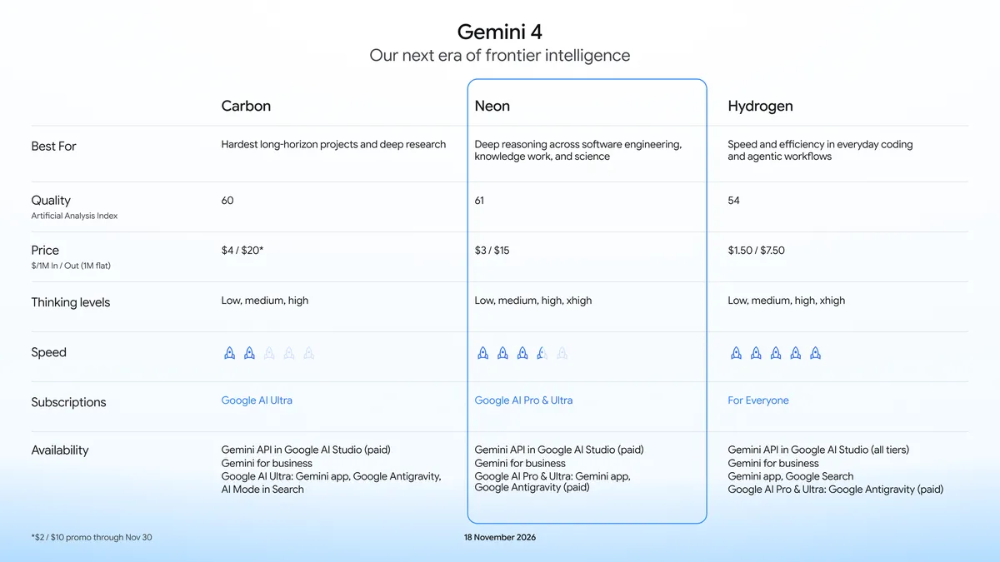

# AI Daily 2026-11-19

封面色：极光

## 今日一句话

> 中间档今天可以调用：Neon 夹在 Carbon 标价与促销价之间，Copilot 新模型按五折促销价比较。

## 今日要闻

### 1. Google: Gemini 4 Neon 上线，目录价落在 Carbon 和 Hydrogen 之间
- 来源链接：[发布说明](https://blog.google/innovation-and-ai/models-and-research/gemini-models/introducing-gemini-4-neon/)；[模型卡](https://storage.googleapis.com/deepmind-media/Model-Cards/Gemini-4-Neon-Model-Card.pdf)；[AI Studio 入口](https://aistudio.google.com/prompts/new_chat?model=gemini-4-neon)；[Hacker News 讨论](https://news.ycombinator.com/item?id=50552424)
- 类型：模型发布
- 推荐指数：★★★★★
- 一句话总结：Gemini 4 Neon 开始推送，AI Studio 链接里的模型参数是 gemini-4-neon。正文写每百万 token 输入 3 美元、缓存输入 0.15 美元、输出 15 美元；同一页对比表把 Carbon 标成 4/20 美元，Hydrogen 标成 1.50/7.50 美元。
- 配图：（图源：Google）
- 关键数字：$3 | 每百万输入 token 的目录价

**为什么重要：** 发布页 `datePublished` 是 2026-11-18T21:00:00+00:00，北京时间 11 月 19 日 05:00，页面上的美国日期是 11 月 18 日。Gemini 4 已经有 Carbon 和 Hydrogen：Carbon 在对比表里对应最难的长程项目，Hydrogen 对应日常速度。表上的目录价是每百万 token 的输入和输出：Carbon 4 美元和 20 美元，脚注写到 11 月 30 日促销为 2 美元和 10 美元；Neon 是 3 美元和 15 美元；Hydrogen 是 1.50 美元和 7.50 美元。正文另写缓存输入 0.15 美元，是标准输入的 95% 折扣。模型卡写 Neon 由 Gemini 4 Carbon 改来，输入可以是文本、图像、音频和视频，输入与输出合计最多 100 万 token。

**核心观点：**
1. 对比表把订阅写成：Carbon 是 Google AI Ultra，Neon 是 Pro 与 Ultra，Hydrogen 是所有人。可用范围一行里，Neon 的 API 是付费档，入口参数为 gemini-4-neon；企业走 Gemini for business；Pro 与 Ultra 可以在 Gemini 应用和付费的 Antigravity 里选。Hydrogen 的 API 在表上写成所有档位。
2. 思考档在表上是 low、medium、high、xhigh。正文写 xhigh 时，Artificial Analysis Intelligence Index 为 61，总排名第 3，落在更大、更慢的模型后面。表上的质量行是 Carbon 60、Neon 61、Hydrogen 54。默认 high 的单任务成本，Google 称比 Carbon 低 32%。这是任务成本，不是把 3 美元和促销中的 2 美元比大小。
3. 模型卡写默认同步输出最多 64K token，后台长解码最多 100 万 token。正文还写 Vals Index 第 2、70.9%，FrontierCode 2.0 在默认 high 为 46.2%，SWE-sweep 在 mini-SWE 上 12.8%、在 Antigravity 里 39.0%。网络安全变体写的是未来几天向 Fairwind 计划中的受信任防御方推送。

**这意味着什么：** Gemini 4 这条线里，Carbon 承担长程难题，Hydrogen 承担日常速度，Neon 由 Carbon 改来，补的是两者中间、今天就能调用的一档。OpenAI 昨天把旗舰 Astra 的目录价下调，Sol 的目录价不动。Google 今天不是替换 Carbon，而是把高频的复杂工作单独标价。目录价上，Neon 低于 Carbon 的 4/20 美元，高于其到 11 月 30 日的 2/10 美元促销，也高于 Hydrogen。调用方要先看自己落在哪一档订阅，再看思考档和缓存有没有命中。

**风险与待验证：** 32%、61 分、总排名第 3、70.9%、46.2%、12.8% 和 39.0% 都来自 Google 的发布页或该页上的表，本报未复跑。表上的 60/61/54 没有逐格写明思考档，xhigh 的限定在正文里。开始推送不等于每个付费账号当天都能选到。内部测试里的「迄今最低编造率」没有绝对数字。Carbon 的促销价写到 11 月 30 日。网络安全变体还不是公开 API。

### 2. 微软: MAI Code 2 与 Flash 进入 GitHub Copilot
- 来源链接：[Code 2 说明](https://microsoft.ai/news/introducing-mai-code-2-and-mai-code-2-flash/)；[Ignite 总览](https://microsoft.ai/news/microsoft-ignite-2026/)；[Hacker News 讨论](https://news.ycombinator.com/item?id=50535885)
- 类型：产品更新
- 推荐指数：★★★★★
- 一句话总结：MAI Code 2 与 MAI Code 2 Flash 进入 GitHub Copilot。官方称四项日常编程基准上，Code 2 达到 GPT-6.1 Sol 的 98%、成本约 40%，达到 Claude Opus 5.5 的 96%、成本约 5%；脚注写成本按 50% 促销价计算。
- 关键数字：50% | 成本对比使用的促销价

**为什么重要：** Code 2 说明的 `datePublished` 是 2026-11-17T18:15:16+00:00，北京时间 11 月 18 日 02:15。GitHub Copilot 里原来调用的是别人的前沿编程模型。微软今天把两款自己的模型放进 GitHub Copilot：Code 2 面向把代码送进生产、深度调试、多文件实现和仓库级推理，Flash 面向解释、小改动和来回迭代。说明写明，它们还没有为硬科学和很长程的 agent 任务调过。这篇没有给出脱离促销的目录价，成本句都挂在脚注的 50% 促销价上。

**核心观点：**
1. 两款今天都在 GitHub Copilot 里。Flash 另有 Microsoft Foundry 的限量预览。OpenRouter、Vercel、Hermes、OpenCode 和 Kilo 写的是即将，不是今天。
2. 四项基准是 DeepSWE 1.1、Terminal Bench 2.1、SWE-Atlas 和 FrontierCode v1.1，都开到最高推理档。前三项在微软内部的 MSBench 上、用 GitHub Copilot CLI、不带子 agent。FrontierCode 的分数和成本来自 Artificial Analysis。98% 对 40%、96% 对 5%，都按 50% 促销价。
3. 前端盲测里，258 名标注者在界面、游戏、可视化和 SVG 上，有 64% 的偏好给了 Code 2 而不是 GPT-6 Sol。Flash 在前三项基准上被写成与 GPT-6 Luna、Claude Haiku 5.5 接近，成本分别为 65% 和 20%，同样按 50% 促销价。

**这意味着什么：** 日常编程这档，对照物是 Copilot 里已经在用的 GPT-6.1 Sol 和 Claude Opus 5.5，不是再发一个旗舰。OpenAI 昨天动的是旗舰目录价，Sol 的单价没动。微软今天把自有模型放进编辑器，并用五折促销价来做成本对比，正文没有写出促销结束以后的单价。受影响的是已经在 Copilot 里做日常修改的人。更难的长程任务，说明自己把它留在这款模型的范围外面。

**风险与待验证：** 98%、40%、96%、5%、64%、65% 和 20% 都是微软的评测或它所引用的榜单，本报未复跑，而且成本按 50% 促销价。绝对目录价不在这两页上。盲测只覆盖前端一类任务。Flash 的 Foundry 是限量预览。其他平台的「即将」不能当成已经能调。

### 3. 可灵: Kling Image 4.0 全量上线，并开放 API
- 来源链接：[可灵 AI 公众号](https://mp.weixin.qq.com/s/p3_DIBRUUgmxShjD5Wp27w)；[微软同日图像模型说明](https://microsoft.ai/news/microsoft-ignite-2026/)
- 类型：模型发布
- 推荐指数：★★★★☆
- 一句话总结：可灵 AI 宣布 Kling Image 4.0 全量上线，企业和开发者可以接 API。文中写首次支持原生 8K，单张图最多 2000 字，一次描述最多生成 10 张。
- 关键数字：2000 字 | 单张图最多生成的文字

**为什么重要：** 公众号页面里的 `var ct` 是 1794928231，即 2026-11-17T15:10:31Z，北京时间 11 月 17 日 23:10。可灵把这一版写成理解与生成放在同一套模型里，并同时打开全量和 API。文中的三个规格是：原生 8K、单张最多 2000 字、一次描述最多 10 张系列图。另外写文本输入最高 15000 token，内置 110 多种影调预设和 70 多种商用字体，语言包括简体中文、繁体中文、英文、日文、韩文、西班牙文和葡萄牙文。公众号没有写单价。

**核心观点：**
1. 「首次支持原生 8K」是可灵对自己这一版的说法。文中注明，页面上的 8K 原图经过上传压缩。小字清晰度和多段排版被写成这一版要提升的点，不是独立榜单的分数。
2. 一次描述最多 10 张，文中称为原生 agent 能力：按意图安排每一张的重点。长图覆盖电商详情页和网页视觉稿。已在平台上生成的图，可以再改文字和字体。
3. 同一天微软的 Ignite 总览写，MAI Image 2.7 在 Artificial Analysis 图像编辑上排第 1，并以 GPT Image 2.6 Sunburst（max）五分之一的价格超过它；两款都在 Microsoft Foundry。可灵这篇没有给榜单名次。

**这意味着什么：** 文字入图这条线上，微软同一天拿 MAI Image 2.7 去对 GPT Image 2.6 Sunburst。可灵补上的不是一个名次，而是三个能在公众号里对上的规格，加上企业和开发者 API、以及「现已全量上线」这句。图像模型若只停在样张，分辨率和字数都无法核对；这一版至少把 8K、2000 字和 10 张写成了可以打开的产品。没有单价，就还不能把它和按张计价的接口放在同一条成本线上。

**风险与待验证：** 真实感、小字清晰和「接近相机直出」都是可灵的表述，这篇没有独立复测。8K 样张在文中已经写明经过压缩。原生 8K 是可灵这一版的「首次」，不是行业里第一次出现 8K。API 的路径和价格不在这篇里。微软的第 1 名和五分之一价格来自 Ignite 总览，本报未复跑，也不把两家写成同一套测试。

## 快讯

1. **微软 · Decision 1.1 正式可用**：Foundry 每百万输入 token 0.042 美元，输出免费，请求可以带图片。[来源](https://commandline.microsoft.com/microsoft-decision-model-ga/)
2. **Google · Genie 4 向符合条件的 Ultra 开放**：会话中可改世界，并有实时原生音频；Pro 只能候补。[来源](https://deepmind.google/blog/genie-4-is-now-available/)
3. **Cerebras · 分离推理已投产**：Instinct 预填充、CS-3 解码，官方称同速下每兆瓦为纯 CS-3 的 5 倍。[来源](https://www.cerebras.ai/blog/cerebras-launches-disaggregated-inference)
4. **Google · AI Studio 可绑自定义域名**：官方账号宣布，Build 里的应用能发到自己的域名。[来源](https://x.com/GoogleAIStudio/status/2122817812200555003)
5. **Google · 更低内存的 Android 也能打开 Gemini**：官方写这些设备可以使用 Gemini Live 和自定义图像。[来源](https://blog.google/innovation-and-ai/products/gemini-app/gemini-lower-memory-devices/)

## 值得研究的开源项目

1. 项目名：affaan-m/ECC
   GitHub 链接：[affaan-m/ECC](https://github.com/affaan-m/ECC)
   Star 数：306,483（2026-11-19）
   解决什么问题：把计划、测试、实现、复查、记住和下一次复用装成一套可安装的流程，而不是每次对话重写一遍。
   为什么值得看：README 把这条路径写成 `plan -> test -> implement -> review -> verify -> remember -> improve`，并写 Claude Code 目前最完整，Codex、Cursor、OpenCode 等是能力有限的适配，不能假设功能对齐。同页写有 72 个 agent、327 个技能。采集截止 08:08 的候选笔记记今日 +1,108、共 306,483。仓库创建于北京时间 2026-01-18 08:51。许可证 MIT。
2. 项目名：HKUDS/CLI-Anything
   GitHub 链接：[HKUDS/CLI-Anything](https://github.com/HKUDS/CLI-Anything)
   Star 数：59,720（2026-11-19）
   解决什么问题：给原来只有图形界面的软件补一层命令行，让编程 agent 按命令驱动它。
   为什么值得看：README 写 `pip install cli-anything-hub`，再用 `cli-hub install` 安装社区做好的命令行。agent 面对的是可脚本化的命令，而不是一次次点击截图。采集截止 08:08 的候选笔记记今日 +389、共 59,720。仓库创建于北京时间 2026-03-08 21:52。许可证 Apache-2.0。
3. 项目名：n8n-io/n8n
   GitHub 链接：[n8n-io/n8n](https://github.com/n8n-io/n8n)
   Star 数：211,064（2026-11-19）
   解决什么问题：用可视化流程接上自定义代码，把模型调用和已有的业务系统串起来。
   为什么值得看：仓库描述写它可以自托管或用云，并带 400 多个集成。GitHub API 的 license 字段是 NOASSERTION。描述里写的是 fair-code，不是 MIT 或 Apache。采集截止 08:08 的候选笔记记今日 +325、共 211,064。仓库创建于北京时间 2019-06-22 17:24。
