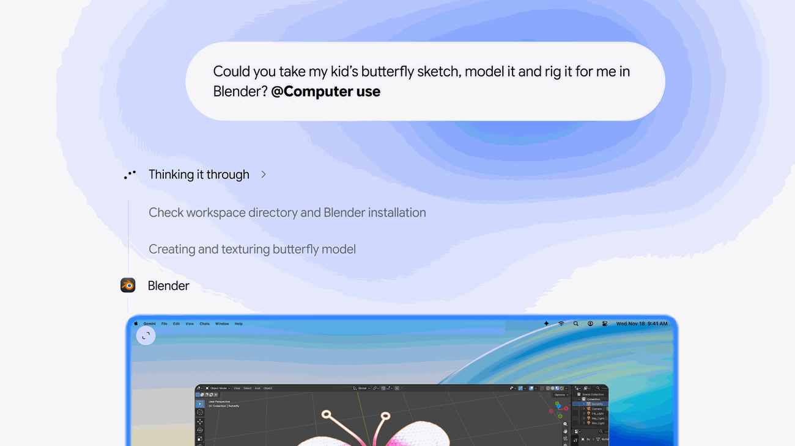

# AI Daily 2026-11-20

封面色：橄榄

## 今日一句话

> 平静的一天：Mac 上的 Gemini 开始在后台点按，语音 API 把待机单独标价。

## 今日要闻

### 1. Google: Gemini 的 Mac 应用可以在后台操作本机
- 来源链接：[官方博客](https://blog.google/innovation-and-ai/products/gemini-app/computer-use-mac/)；[OpenAI computer use 文档](https://developers.openai.com/api/docs/guides/tools-computer-use)
- 类型：产品更新
- 推荐指数：★★★★★
- 一句话总结：Gemini 的 Mac 应用从今天起推送计算机使用，在隔离窗口里点按本机应用和网页；范围是美国英语，脚注要求 Apple Silicon、macOS Sequoia 15.0 及以上，以及 18 岁以上的个人付费账号。
- 配图：（图源：Google）
- 关键数字：15.0 | macOS Sequoia 的最低版本

**为什么重要：** 发布页 `datePublished` 是 2026-11-19T17:00:00+00:00，北京时间 11 月 20 日 01:00，页面上的美国日期是 11 月 19 日。桌面和浏览器上的计算机使用已经有了。OpenAI 的 computer use 文档同时写了持久桌面和持久浏览器：桌面示例用 Python 和 PyAutoGUI，浏览器示例用 Playwright 跑 JavaScript。[TechCrunch](https://techcrunch.com/2026/11/19/google-gives-gemini-the-ability-to-use-your-mac-for-you/) 这篇写，OpenAI、Anthropic 和 Meta 的桌面应用里，这类 agent 功能已经提供过一段时间。11 月 12 日这期记过 Antigravity 的浏览器使用。11 月 17 日，OpenAI 把计算机使用 agent 开放给医疗版客户。11 月 18 日这期写的 Gemini Tasks 跑在云端的 Agent Compute Engine 上，连接的是账号里的应用，不是本机界面。今天这一条是 Gemini 的 Mac 应用：符合资格的个人付费账号，在后台独立窗口里点按本机应用和网页，主屏幕和主光标仍留给人。

**核心观点：**
1. 正文写从今天起推送，语言是英语，地区是美国，下载地址是 gemini.google/mac。脚注 1 写明要 Apple Silicon、macOS Sequoia 15.0 及以上，个人 Google 账号且年满 18 岁，并提供给 Google AI Plus、Pro 和 Ultra。这句和「美国英语」是两条限制。
2. Gemini 在隔离的后台窗口里工作，聊天里有实时预览。正文写主屏幕和光标仍然空着，人可以选择它能打开哪些应用，可以随时暂停，关键动作要先批准。
3. 页面举的例子是给照片批量调色、用本地 PDF 填运单、从仪表盘做幻灯片、以及把衣物照片做成转售列表。这些是用法说明，不是测得的成功率。

**这意味着什么：** 计算机使用这条线里，桌面和浏览器都已经能被模型操作。OpenAI 的文档把持久桌面和持久浏览器放在同一页。11 月 18 日的 Tasks 是云端连接应用。今天 Google 补上的是消费级 Mac 应用里的后台窗口，主光标还给正在用电脑的人。受影响的是美国、英语、脚注里的付费个人账号和 Apple Silicon。免费档、Intel Mac 和 Windows 不在这篇里。

**风险与待验证：** 「开始推送」不等于每个符合条件的账号当天都能用。例子没有成功率。官方写的隔离窗口、可选应用、实时预览、可暂停和关键动作先批准，是产品控制说明。这几句不等于虚拟机硬件隔离，不等于推理留在本机，不等于数据不出这台机器，不等于任意权限，也不等于付款不会自动发生的保证。脚注里的机型和套餐，与正文的美国英语，要同时满足。

### 2. OpenAI: GPT-Live-1.1 进入 API，WebRTC 会话可以待机
- 来源链接：[更新日志](https://developers.openai.com/api/docs/changelog)；[模型页](https://developers.openai.com/api/docs/models/gpt-live-1.1)；[会话文档](https://developers.openai.com/api/docs/guides/live-conversations)；[10 月 15 日官推](https://x.com/OpenAI/status/2110797830361436604)
- 类型：模型发布
- 推荐指数：★★★★☆
- 一句话总结：10 月 15 日已在产品端推送、当时写 API 即将提供的 GPT-Live-1.1，今天写进 API 更新日志；活跃每分钟 0.05 美元，WebRTC 推理暂停每分钟 0.02 美元，价目按分钟列出，按秒计。
- 关键数字：$0.02 | 推理暂停每分钟，活跃为 0.05 美元

**为什么重要：** 更新日志把 GPT-Live-1 的 API 正式可用写在 9 月 10 日。10 月 15 日官方账号的帖子 `created_at` 是 2026-10-15T18:19:54Z，北京时间 10 月 16 日 02:19:54，正文写 GPT-Live-1.1 正在向所有用户推送，覆盖 ChatGPT、Codex 和 dots，并写 API 即将提供。今天的更新日志把模型 ID `gpt-live-1.1` 记在 Nov 19，没有时区，也没有钟点。采集截止时这页没有给出精确首发时刻，这里不补钟点，也不把 11 月 19 日整天都算进窗口。同一条写，GPT-Live-1 和 GPT-Live-1.1 的 WebRTC 会话可以配置待机：空闲时暂停推理，有人说话再恢复。计费状态是推理活跃或暂停，沉默不等于待机。[定价页](https://developers.openai.com/api/docs/pricing#live-session-duration)把两款都标成活跃每分钟 0.05 美元、待机每分钟 0.02 美元，并写语音会话按秒计。GPT-Live-1 的模型页还写，时长不进位到下一整分钟。较低的待机价用在推理暂停的 WebRTC 会话。后端模型和工具另计。[成本说明](https://developers.openai.com/api/docs/guides/voice-latency-cost)写，空闲超时耗尽之前的沉默仍算活跃，麦克风静音也让会话保持活跃。

**核心观点：**
1. 模型页写 GPT-Live-1.1 可以一边听一边说。相对 GPT-Live-1，它写转录更准，跨语言的口音和声音更一致。什么时候把任务交给后端做推理或调用工具，用普通语言描述。输入是音频和文本，输出也是音频和文本。端点只支持 `v1/live/sessions`，不支持 Chat Completions、Responses 和 Realtime。
2. 会话文档写，创建 WebRTC 会话时把 `session.wake_policy.type` 设为 `speech`，会等有人说话再开始推理。`session.idle_timeout_s` 取 5 到 60 的整数，表示多少秒没有输入或输出文字稿，推理才暂停并进入待机。省略这个超时，第一次唤醒之后推理保持活跃，直到会话结束。`vad_threshold` 从 0 到 1，默认 0.5。待机时麦克风轨道要保持打开，连接和会话 ID 不变。超时之前的沉默仍按活跃计。
3. 待机写在 GPT-Live-1 和 1.1 两条上，不是 1.1 的首发，也不是 1.1 独有的降价。两款模型页现在都列出 0.05 美元和 0.02 美元。更新日志没有写这组价格相对哪一天的旧价下降了多少。

**这意味着什么：** 全双工语音这条线，9 月 10 日是 GPT-Live-1 的 API，10 月 16 日北京时间 02:19:54 的帖子是 1.1 先到产品里、API 写即将。今天补上的是更新日志里的 `gpt-live-1.1`，以及 1 与 1.1 共用的 WebRTC 待机。两档价按推理在跑还是已暂停来分。人没说话、空闲超时还没到，仍可能停在 0.05 美元那一档。受影响的是已经接 Live API 的应用。省略超时会让推理在第一次唤醒后一直活跃，这个开关比模型 ID 更容易把账单留在 0.05 美元那一档。

**风险与待验证：** 「转录更准」「口音和声音更一致」是模型页的表述，没有分数，本报未复测。更新日志只有 Nov 19，没有时区和钟点，精确首发时刻在截止时没有提供。待机价只写了推理暂停的 WebRTC。标价按分钟列出，计费按秒。后端调用不包含在时长价里。10 月 15 日帖子里的新语音语种，是当时的产品推送，不是今天的 API 变更。

## 快讯

1. **Google · Interactions API 预览工具检索**：模型可先只看工具名和说明，需要时再加载参数 schema。检索不单独收费，输入和输出 token 仍按所调模型的标准价计。适用于 Gemini 3.6 及之后，包括全部 Gemini 4。[公告](https://blog.google/innovation-and-ai/technology/developers-tools/gemini-api-tool-retrieval/)
2. **Google · Genie 4 进入 Gemini API**：昨天是符合条件的 Ultra，今天是付费 Gemini API 和 AI Studio。API 要用付费档密钥，不包含在 Ultra 订阅里，按 token 计费，不是免费。文档写每帧 240 个视频输出 token，含立体声约每秒 0.10 美元。[公告](https://blog.google/innovation-and-ai/technology/developers-tools/genie-4-in-gemini-api/) [文档](https://aistudio.google.com/docs/genie)
3. **Google · Stitch Loop 开放全球候补**：长时产品 agent 连接代码库与线上指标，改动以待审 PR 交付；候补全球开放，符合条件的 Ultra 优先。[公告](https://blog.google/innovation-and-ai/models-and-research/google-labs/stitch-loop/)
4. **OpenAI · Accounting 插件现已可用**：官方账号称 ChatGPT for Accounting 现已可用，插件覆盖月末报告、银行对账、录入和审计准备，并点名 QuickBooks。[帖子](https://x.com/ChatGPT/status/2123159134963196357)

## 值得研究的开源项目

1. 项目名：firecrawl/firecrawl
   GitHub 链接：[firecrawl/firecrawl](https://github.com/firecrawl/firecrawl)
   Star 数：204,199（2026-11-20）
   解决什么问题：把网页变成干净的 Markdown，给 agent 一个本机、云端或自托管的入口。
   为什么值得看：README 把同一套能力分成三种跑法。本地版是一个二进制，不需要数据库、队列或容器，安装走 crates.io；需要搜索时再接到云端。云端另写有 550 多个数据提供方。采集截止 08:13 的候选池记在当日 GitHub Trending，本轮没有重拉当前榜。仓库创建于 2024-04-15。许可证 AGPL-3.0。
2. 项目名：cathrynlavery/diagram-design
   GitHub 链接：[cathrynlavery/diagram-design](https://github.com/cathrynlavery/diagram-design)
   Star 数：68,622（2026-11-20）
   解决什么问题：让编程 agent 交出一份自包含的 HTML 加 SVG 图，而不是再生成一份 Mermaid。
   为什么值得看：README 写有 51 种图，安装命令是 `npx skills add cathrynlavery/diagram-design`。成品是单个 HTML 文件，并写可以按品牌改外观。采集截止 08:13 的候选池记在当日 GitHub Trending，本轮没有重拉当前榜。仓库创建于 2026-04-16。许可证 MIT。
3. 项目名：jingyaogong/minimind
   GitHub 链接：[jingyaogong/minimind](https://github.com/jingyaogong/minimind)
   Star 数：66,845（2026-11-20）
   解决什么问题：README 开篇写约 2 小时、约 3 元从零训练约 64M 参数的小模型；同页注明，这是单张 3090 上 SFT 跑完 1 个 epoch 的耗时和 GPU 租用，不是全流程账单。
   为什么值得看：核心算法用 PyTorch 原生实现。仓库里另有预训练、LoRA，以及 DPO、PPO 和 GRPO 的代码，那些阶段不包含在这 2 小时和 3 元里。采集截止 08:13 的候选池记在当日 GitHub Trending，本轮没有重拉当前榜。仓库创建于 2024-07-27。许可证 Apache-2.0。
