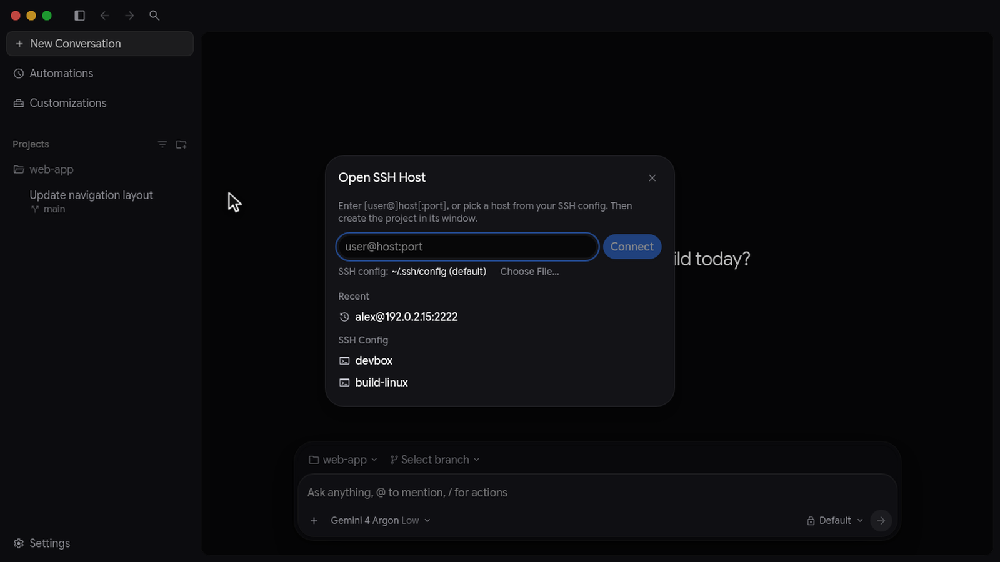
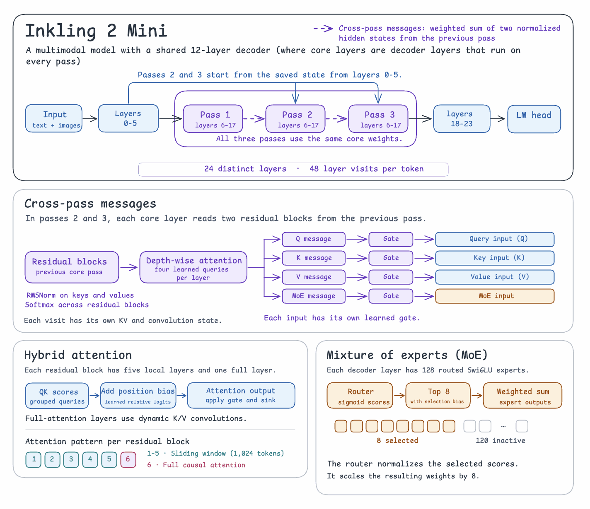

# AI Daily 2026-11-21

封面色：海蓝

## 今日一句话

> 今天多出来的两件东西，都放在用户自己的机器上：一份 26.4B 的开放权重，以及关了窗口还在跑的远程 agent。

## 今日要闻

### 1. Google: Antigravity 桌面应用可以用 SSH 连上远程 Linux
- 来源链接：[官方文档](https://antigravity.google/docs/ssh)；[官方账号](https://x.com/antigravity/status/2123476398601908551)
- 类型：产品更新
- 推荐指数：★★★★☆
- 一句话总结：Antigravity 桌面应用可以用本机 OpenSSH 连接用户自己的 64 位 Linux，项目和 agent 在远程主机上跑；关掉窗口或笔记本睡眠后，远程进程仍继续。
- 配图：（图源：Google）
- 关键数字：2.33.0 | 桌面应用的最低版本

**为什么重要：** 官方账号帖子的 `created_at` 是 2026-11-19T18:00:00Z，北京时间 11 月 20 日 02:00，正文写桌面应用里的原生 SSH 现已可用，并点名这是 Remote Control 之外的连接方式。文档页没有 `datePublished`。文档把远程方式分成三行：SSH 的 agent 跑在用户自己的 Linux 上，客户端是桌面应用，主机侧不用另装；Remote Control 用浏览器控制用户自己的桌面或服务器；Remote Agents 面向 Pro 和 Ultra，跑在 Google 托管环境。编辑器通过 SSH 把工作区放到远程 Linux，VS Code 和 Cursor 已经这样做。今天这一条是 Antigravity 桌面应用补上的第三种：主机是用户的 Linux，本地窗口关掉、笔记本睡眠，主机上的 agent 仍继续。

**核心观点：**
1. 本地电脑要装 Antigravity App 2.33.0 或更高版本，系统是 macOS、Windows 或 Linux，并且 PATH 里有 OpenSSH，或设置 `ANTIGRAVITY_SSH_BIN`。远程端只支持 64 位 Linux，架构是 x86_64 或 arm64，glibc 2.26 或更高，文档举例 Ubuntu 18.04+、Debian 10+、RHEL 8+。macOS、Windows 和 musl Linux（例如 Alpine）不能当远程端。主机和跳板的 `sshd_config` 要允许 `AllowTcpForwarding yes` 或 `local`。
2. 每个主机会开一个标题带 `SSH: <host>` 的窗口。项目、Git worktree、终端、技能、规则、钩子、MCP 和插件都从主机上的目录加载。关掉窗口会断开 SSH，远程 server 和 agent 继续跑，之后可以再连。笔记本睡眠或断网时客户端会重试，主机上的进程保持。`Stop SSH Server…` 才会停掉主机上的 agent、sidecar 和 server。
3. 和本地窗口的差别写在同一页：侧栏内置浏览器不出现，网页链接用本地默认浏览器打开；`/browser` 连的是远程主机上打开了远程调试的 Chrome，不是本地电脑；摄像头和屏幕访问保持关闭；语音会询问是否允许这台主机使用麦克风。

**这意味着什么：** 编程 agent 放到远程机器上，Antigravity 自己的文档里已经有两条：Remote Control 控制用户手头的桌面，Remote Agents 把任务放进 Google 托管环境。VS Code、Cursor 则早就用 SSH 把工作区接到 Linux。今天补上的是桌面应用里的第三种，主机是用户自己的 Linux，人合上笔记本之后任务还在那台机器上。受影响的是已经有符合 glibc 条件的 Linux 主机、并且桌面应用到了 2.33.0 的人。远程端不是 macOS 或 Windows。Pro 和 Ultra 仍然是托管 Remote Agents 那一栏的条件，不是这条 SSH 的标价。

**风险与待验证：** 「现已可用」来自官方账号 11 月 20 日 02:00（北京时间）的帖子。文档没有发布时刻，也没有写每个账号当天都能看到 2.33.0。主机密钥、端口转发、glibc 和可执行的 `$HOME` 都是连上之前的条件。关掉窗口后续跑，不等于推理留在用户电脑上，也不等于主机被隔离。摄像头和屏幕在 SSH 窗口里保持关闭，这是文档写明的限制。

### 2. Thinking Machines: 放出 Inkling 2 Mini 权重，激活参数 3.4B
- 来源链接：[模型卡](https://huggingface.co/thinkingmachines/Inkling-2-Mini)；[Hugging Face 文章](https://huggingface.co/blog/inkling2mini)；[Tinker 试用](https://tinker.thinkingmachines.ai/playground)；[Inkling 2 Small](https://huggingface.co/thinkingmachines/Inkling-2-Small)
- 类型：模型发布
- 推荐指数：★★★★☆
- 一句话总结：Thinking Machines 放出多模态模型 Inkling 2 Mini 的 Apache 2.0 权重，总参数 26.4B、激活 3.4B，上下文 1M token，输入是文字和图像，输出是文字。
- 配图：（图源：Hugging Face）
- 关键数字：3.4B | 激活参数，总参数 26.4B

**为什么重要：** 模型卡写发布日期是 November 20, 2026。仓库里 `upload model` 的提交时间是 2026-11-20T22:02:14Z，北京时间 11 月 21 日 06:02。同一系列的 Inkling 2 Small 在 2026-11-12T19:53:15Z 上传权重，北京时间 11 月 13 日 03:53，模型卡写总参数 594B、激活 17B。Mini 的检查点大约 20GB，用 NVFP4 和 MXFP8。模型卡建议 Apple 芯片至少 32GB 内存，其他 GPU 至少 32GB 显存，并写明可以在一台 NVIDIA DGX Spark 上跑。本地推理列出了 transformers、SGLang、vLLM、llama.cpp、MLX、Llama App 和 Ollama。输出只有文字。

**核心观点：**
1. 架构是 24 层 decoder。中间 12 层共享权重跑三遍，所以每个 token 有 48 次层计算，权重仍是 24 层。每一层把 token 送到 128 个专家里的 8 个。模型卡写总参数 26.4B、激活 3.4B，并注明每多一轮循环大约增加 1.0B 有效激活，三轮之后有效激活是 5.4B。对照表把激活/总参数写成 5/26，旁边的 Qwen3.8-27B 是 27/27，Gemma 4 31B 是 31/31。上下文最长 1M token。
2. 模型卡的对照表里，AA Index v5.0 上 Mini 和 Qwen3.8-27B 都是 20.1，Gemma 4 31B 是 4.4，Muse Glimmer 是 6.3，Nemotron 3.5 Super VL 是 13.6。Terminal-Bench v4.0、mini-swe-agent v2.4.6 这一行，Mini 和 Qwen3.8-27B 都是 5.6%。Terminal-Bench v2.1、pi v0.83.0 这一行，Mini 是 71.6%，Qwen3.8-27B 是 73.0%。两行不能当成同一个终端基准。
3. 推理可以走 Tinker playground。同日的研究检查点是 `thinkingmachines/TML-d24-varloop-research`，许可证也是 Apache 2.0，可以改循环次数。Hugging Face 的文章写，设成 1 轮或 2 轮会更快，但他们没有做充分评估。

**这意味着什么：** 开放权重的本地模型这条线里，Inkling 2 Small 先把 594B、17B 激活的检查点放出来。模型卡拿来并排的是 Qwen3.8-27B 和 Gemma 4 31B 这种大约 30B 的稠密模型。今天 Mini 补的是一张 32GB 机器放得下的检查点，并用三轮共享权重把有效激活写成 5.4B。判断要停在对照表里面：指数打平，终端两行一个打平、一个落后，不是每一项都领先。要换本地模型的人，得先对上自己用的 harness 和那一行的版本号。第三方复测还没有进这张表。

**风险与待验证：** 表里的分数是 Thinking Machines 填的，本报没有复测。有的格子是横杠。安全表里的 Misbehavior、Covert misbehavior、Destructive actions 标明是内部项。Hugging Face 文章里的着色器和手绘稿是演示，不是这张表的一行。有效激活 5.4B 对应三轮循环。研究检查点改轮数之后的质量，文章写尚未充分评估。模型卡写语言是英语和一般的多语言支持，没有单独给出中文分数。

### 3. Ideogram: 图像模型 4.6 上线，输出支持到 4K
- 来源链接：[模型页](https://ideogram.ai/models/4.6)；[官方账号](https://x.com/ideogram_ai/status/2123461101224624402)；[4.5 模型页](https://ideogram.ai/models/4.5)
- 类型：模型发布
- 推荐指数：★★★★☆
- 一句话总结：Ideogram 4.6 已在应用和 API 提供生成与 Precise Edit，输出支持 2K 和 4K；Very low 画质只到 2K，High 画质的 4K 编辑是每张 0.60 美元。
- 关键数字：4K | 输出上限；Very low 只到 2K

**为什么重要：** 模型页写发布日期是 November 19, 2026。官方账号帖子的 `created_at` 是 2026-11-19T16:59:13Z，北京时间 11 月 20 日 00:59，正文写精确编辑进入原生 4K。4.5 的模型页写的是四种画质、原生 2K。4.6 的页面写支持 2K 和 4K，Very low 只到 2K，Precise Edit 保持原图尺寸。Generate 最多带 5 张参考图。Precise Edit 可以选一块遮罩，不传遮罩就用文字描述要改的地方。API 端点是 Generate 和 Precise Edit。

**核心观点：**
1. 价格表按每张图计，单位是美元。Very low：生成 2K 是 0.008，编辑 2K 是 0.008，4K 两格是横杠。Low：生成 2K 0.03、生成 4K 0.06、编辑 2K 0.03、编辑 4K 0.06。Medium：0.06、0.12、0.06、0.20。High：生成 2K 0.10、生成 4K 0.20、编辑 2K 0.22、编辑 4K 0.60。页面写 API 从 Very low、最高 2K 的每张 0.008 美元起。
2. 页面引用 Rapidata 的 Multi-step Image Edit 总榜，快照日期是 November 17, 2026。评测配置写的是 Ideogram 4.6 Precise Edit、High 画质，分数 1,892 ± 32，排第一。同一张表上 Ideogram 4.5 是 1,866 ± 30，Seedream 5.5 是 1,805 ± 29，FLUX 3 Image 是 1,697 ± 27，Muse Image 是 1,406 ± 22，MAI-Image-2.6 是 1,299 ± 22，Qwen-Image-2.1-Pro（Thinking）是 1,291 ± 21。4.6 和 4.5 的区间重叠。
3. 页面 FAQ 写，在该页 High 画质的五项编辑任务上，4.6 比 4.5 给出更多能用的结果，五项是角色一致、精确颜色、产品细节、产品图和遮罩编辑。同一段写，换掉已经在用的流程之前，先用自己的图和请求再比一次。

**这意味着什么：** 多轮图像编辑这条线里，Ideogram 4.5 停在原生 2K。同一份 Rapidata 快照上，Seedream、FLUX、Muse、MAI-Image 和 Qwen-Image 都在榜上。今天 4.6 补的是 4K 这一档，以及一张按画质、分辨率、生成还是编辑分开的价目。判断：和自家 4.5 的榜差落在页面公布的误差区间里，快照日期还比页面写的发布日早两天。要换 API 的人，先看 High 画质 4K 编辑是每张 0.60 美元，不是 2K 编辑的 0.22 美元。

**风险与待验证：** 排名和五项编辑对比都来自 Ideogram 自己的页面，本报没有复测。1,892 ± 32 和 1,866 ± 30 有重叠，不能读成稳定拉开了 4.5。快照是 11 月 17 日，模型页写的发布日是 11 月 19 日。Very low 没有 4K 价格。Precise Edit 保持原图尺寸，不等于每一张 4K 编辑都会改变像素尺寸。

## 快讯

1. **Hugging Face · 放出 Qwen3.8-27B 的 harness LoRA**：官方自测 Pi：SWE-bench Pro 困难 51 题、thinking 关，39.2% 到 64.7%，非全榜。[文章](https://huggingface.co/blog/harness-adapters-at-scale)
2. **OpenAI · Health 进入更多客户端**：美国桌面与 Android：Free、Go、Plus、Pro。Sites：Plus、Pro。dots：Pro。[帖子](https://x.com/ChatGPT/status/2123545961381216325)

## 值得研究的开源项目

1. 项目名：Tracer-Cloud/opensre
   GitHub 链接：[Tracer-Cloud/opensre](https://github.com/Tracer-Cloud/opensre)
   Star 数：13,603（2026-11-21）
   解决什么问题：CI 失败之后，用一个可自托管的命令行 agent 读失败的运行、追原因，并提交一份等人复核的修复。
   为什么值得看：README 把它标成 public alpha，模型由使用者自己接，改动要人看过再合并。采集截止 08:06 的候选池记在当日 GitHub Trending。本轮未见该次原始片段，未独立复核上榜，也未重拉当前榜。仓库创建于 2026-01-13。许可证 Apache-2.0。
2. 项目名：zhouxiaoka/autoclip
   GitHub 链接：[zhouxiaoka/autoclip](https://github.com/zhouxiaoka/autoclip)
   Star 数：12,171（2026-11-21）
   解决什么问题：把一条长视频链接剪成短视频，并生成字幕、封面和发布文案，渲染在本机完成。
   为什么值得看：README 写软件免费，云端模型按量计费，桌面、CLI 和 MCP 一起提供。采集截止 08:06 的候选池记在当日 GitHub Trending。本轮未见该次原始片段，未独立复核上榜，也未重拉当前榜。仓库创建于 2025-07-08。许可证 MIT。
3. 项目名：mjmirza/app-store-compliance
   GitHub 链接：[mjmirza/app-store-compliance](https://github.com/mjmirza/app-store-compliance)
   Star 数：2,727（2026-11-21）
   解决什么问题：把 App Store 和 Google Play 的常见拒审写成提交前可以检查的条目，并带一个给编程 agent 用的 skill。
   为什么值得看：仓库简介写有 117 条有记录的拒审模式。规则放进 agent 能跑的检查里，而不是只留在一篇说明里。采集截止 08:06 的候选池记在当日 GitHub Trending。本轮未见该次原始片段，未独立复核上榜，也未重拉当前榜。仓库创建于 2026-06-06。源码可见，许可受限，不与 MIT 或 Apache-2.0 等同。GitHub API 的 license 字段是 NOASSERTION。README 徽章和仓库 LICENSE 写 OpenRoots ORA 2.3（SPDX LicenseRef-OpenRoots-ORA-2.3），不是 OSI 批准的自由开源许可。法律文本的默认 Threshold Amount 是 Twenty Million United States Dollars（年收入 2000 万美元），每年 1 月 1 日按美国 CPI-U 调整。超过该门槛后，Production Use 按 Attributable Revenue 超出门槛的部分收 0.5%，每个 Legal Entity 每个日历年上限 Two Hundred and Fifty Thousand United States Dollars（25 万美元）。第 1.10 节的 AI Training Use 包括 training、fine-tuning、distillation、reinforcement、retrieval augmentation、embedding generation 和 evaluation。第 6.1 节写明，第 2 节和第 3 节不授予这项权利，须另取 Compute 许可并支付 Compute Fee。[法律文本](https://openroots.org/licenses/ora/2.3/legalcode.txt)
