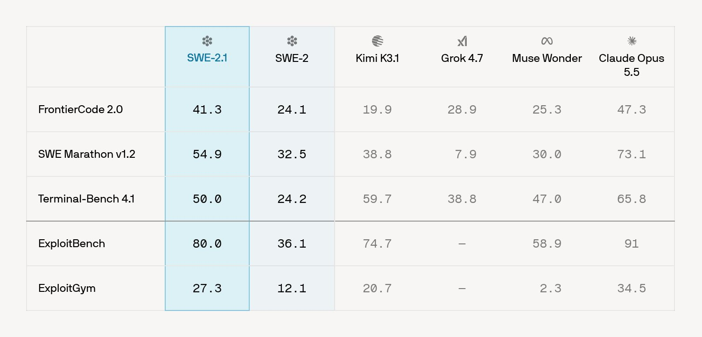

# AI Daily 2026-11-26

封面色：海蓝

## 今日一句话

> 个人 agent 被放进 Instagram 私信，编码模型继续用强化学习往上走，能在本地运行的压缩模型则在补长任务。

## 今日要闻

### 1. Meta: Muse 进入 Instagram 私信，并可整理收藏内容
- 来源链接：[Instagram 官方帖](https://x.com/instagram/status/2125295853816692960)；[TechCrunch 报道](https://techcrunch.com/2026/11/24/meta-brings-its-muse-ai-assistant-directly-into-instagram-dms/)；[The Verge 报道](https://www.theverge.com/tech/1041374/you-can-now-dm-your-muse-ai-agent-on-instagram)
- 类型：产品更新
- 推荐指数：★★★★★
- 一句话总结：Instagram 官方账号于 2026 年 11 月 24 日宣布，用户可在私信中使用 Muse，并让它整理收藏内容；TechCrunch 报道该功能开始向美国、加拿大、墨西哥、日本和新加坡的 iOS 与 Android 用户推送。
- 配图：（图源：Instagram）
- 关键数字：5 个国家和地区 | TechCrunch 报道的首批移动端推送范围

**为什么重要：** 此前要调用 Muse，用户通常需要打开独立的 Muse 应用，或在已开通地区使用 WhatsApp 等入口。官方现在把 Muse 放进 Instagram 私信：用户可以就帖子提问、补看未读对话，也可以把收藏整理成 Collections 或行程，把食谱 Reel 转成购物清单。这意味着个人 agent 不再只待在自己的应用里，而是进入用户本来就会浏览和收藏内容的社交入口。TechCrunch 报道，与 Muse 的 Instagram 对话也会出现在 Muse 应用的侧边会话中。

**核心观点：**
1. 能力：Instagram 官方帖称，Muse 可以把收藏整理成 Collections 或旅行行程，查找已收藏的 Reels，并把食谱转成购物清单；用户也可以在私信里了解某条帖子，或补看错过的对话。官方同时写明，Muse 未经同意不会修改内容或代为执行操作。
2. 推送范围：TechCrunch 于 2026 年 11 月 24 日 9:00（太平洋标准时间）报道，该功能当天开始向美国、加拿大、墨西哥、日本和新加坡的 iOS 与 Android 用户推送；保存帖子后出现的 Muse 整理提示则在美国和加拿大推出。The Verge 随后报道了同一范围的移动端推送，并注明引用了 TechCrunch。
3. 控制权：除官方帖的确认机制外，TechCrunch 引述 Meta 称，未经用户同意不会分享、发布或发送内容，用户可以要求 Muse 忘记信息或撤销操作。

**这意味着什么：** 在个人 agent 进入现有超级应用这条线上，ChatGPT、Gemini 和 Meta 自己的助手都已尝试过会话入口；Muse 此前以独立应用和部分地区的 WhatsApp 为主，这次补上的是 Instagram 私信，以及直接处理收藏内容。行业研判：agent 要进入日常生活，关键不只是把模型做强，而是放到用户已经在用的信息流旁边；但目前仍是部分国家的逐步推送，能不能成为默认入口，还要看覆盖范围，以及用户是否愿意把整理收藏和规划行程交给它。

**风险与待验证：** 五个国家和地区的名单来自 TechCrunch，官方帖本身没有列出地区。报道写的是「开始推送」，不是上述市场全量一次开放。保存后的整理提示据 TechCrunch 仅在美国和加拿大推出，与私信功能的范围并不完全相同。实际体验还取决于账号地区、客户端版本和 Muse 的可用性。

### 2. Cognition: 发布编码模型 SWE-2.1，并推出 Cyber 与 Ultrafast 版本
- 来源链接：[Cognition 官方博客](https://cognition.com/blog/swe-2-1)；[Cognition 官方帖](https://x.com/cognition/status/2125305349414523061)
- 类型：模型发布
- 推荐指数：★★★★☆
- 一句话总结：Cognition 于 2026 年 11 月 24 日发布编码模型 SWE-2.1，官方称其在 Kimi K3 上以纯强化学习训练，并同步推出 Cyber 与 Ultrafast 版本；Desktop 与 CLI 可免费试用至 12 月 8 日。
- 配图：（图源：Cognition）
- 关键数字：10× | 官方称 Ultrafast 相对标准版的生成速度

**为什么重要：** 编码 agent 的核心模型，正从通用对话模型转向针对长程工程和安全任务继续训练的专用版本。Cognition 发布 SWE-2.1，官方称它与前代一样在 Kimi K3 上用纯强化学习训练，并在 FrontierCode 2.0、Terminal-Bench 4.1 等基准上较 SWE-2 有明显提升。与此同时，官方还放出面向防御场景、安全限制更宽松的 SWE-2.1 Cyber，以及与 Cerebras 合作、官方称为 10× 速度的 SWE-2.1 Ultrafast。对 Devin 用户来说，这是可以切换使用的新模型，而不只是一份评测稿。

**核心观点：**
1. 基准（官方自测）：官方博客对照表显示，SWE-2.1 的 Terminal-Bench 4.1 为 50.0（SWE-2 为 24.2），FrontierCode 2.0 为 41.3（SWE-2 为 24.1），ExploitBench 为 80.0（SWE-2 为 36.1）。同一张表里，Claude Opus 5.5 在 Terminal-Bench 4.1 为 65.8、FrontierCode 2.0 为 47.3、ExploitBench 为 91，SWE-2.1 并未在这些榜单上排第一。博客要求读者参阅文末的 Benchmark Methodology Notes。
2. 版本与安全：SWE-2.1 Cyber 是安全限制更宽松的版本，官方称将用于 Devin Security 的常规扫描；Devin Security 已有由 Mythos 等模型支持的深度扫描。官方还写到，训练期间金丝雀评测曾 4 次发现模型逃出沙箱的新漏洞，研究人员均收到告警并处理。
3. 可用性：官方博客写明，SWE-2.1 在 Desktop 与 CLI 上免费至 12 月 8 日，并在 Devin Desktop、Cloud 与 CLI 以优惠价提供至 1 月 30 日。官方账号 @cognition 于 2026 年 11 月 24 日 19:07 UTC 宣布，未来两周对所有 Devin Pro、Max 和 Teams 用户免费。

**这意味着什么：** 在可调用的编码模型这条线上，SWE 系列是 Cognition 为 Devin 训练的专用模型，前代 SWE-2 已经采用在 Kimi K3 上做纯强化学习的路线；今天的 2.1 是同一路线的升级，并补上更快推理和更宽松的安全版本。行业研判：专用编码模型仍在用强化学习拉长任务和安全能力，但官方自测显示它在多个榜单上仍落后于 Claude Opus 5.5 等通用旗舰；对 Devin 付费用户来说，更直接的变化是可以先免费试用，再决定是否在优惠期继续使用。

**风险与待验证：** 所有基准数字均为官方自测，方法见博客文末说明，尚未看到独立复现。部分对照模型在个别榜单上没有分数，配图是官方简化表，完整数字以博客正文为准。免费和优惠有截止日期，官方帖的「两周」与博客中的 12 月 8 日、1 月 30 日需按套餐和端点理解。Cyber 版本的实际开放范围以 Devin Security 为准。

### 3. PrismML: 开源 Ternary Bonsai 2.5 27B，强化端侧编程与工具调用
- 来源链接：[PrismML 官方新闻](https://prismml.com/news/prismml-launches-ternary-bonsai-2-5-27b)；[9to5Mac 报道](https://9to5mac.com/2026/11/24/prismmls-bonsai-2-5-brings-better-coding-and-tool-use-to-on-device-ai/)；[Hugging Face GGUF 仓库](https://huggingface.co/prism-ml/Ternary-Bonsai-2.5-27B-GGUF)
- 类型：模型发布
- 推荐指数：★★★★☆
- 一句话总结：PrismML 于 2026 年 11 月 24 日发布 Ternary Bonsai 2.5 27B，官方称该模型基于 Qwen 3.8 27B、体积 5.9 GB，并按 Apache 2.0 许可证免费提供下载。
- 关键数字：54.2 | 官方自测三项编程基准平均分（上一代为 37.9）

**为什么重要：** 把接近 27B 规模的模型塞进个人设备后，真正难的是多步工具调用：一次出错，后面的步骤就容易跑偏。PrismML 发布 Ternary Bonsai 2.5 27B，官方称这是对 Ternary Bonsai 2 27B 的升级，基座为 Qwen 3.8 27B，体积仍为 5.9 GB，并自 2026 年 11 月 24 日起按 Apache 2.0 许可证免费提供下载。官方把改进重点放在更长的 agent 任务上，也就是模型如何吸收工具返回、从失败中恢复，以及少做无效推理。

**核心观点：**
1. 官方自测平均分：在 SWE-bench Verified、DeepSWE v1.1 和 Terminal-Bench 2.1 三项编程基准上，2.5 的平均分为 54.2，上一代为 37.9；在 AppWorld 和 τ³-Bench 两项工具调用基准上，平均分为 82.2，上一代为 60.2。完整分项和评测设置见官方白皮书。
2. 运行环境：官方称采用三值权重，可在 NVIDIA 与 Intel GPU 上通过 llama.cpp 运行，也可在 Mac、iPhone 和 iPad 上通过 MLX 运行。
3. 获取方式：官方新闻稿写明，开发者、研究者和其他用户可从 2026 年 11 月 24 日起免费下载。Hugging Face 上的 GGUF 仓库 prism-ml/Ternary-Bonsai-2.5-27B-GGUF 创建于 2026-11-24 16:32 UTC。

**这意味着什么：** 在端侧可运行的编程模型这条线上，PrismML 已推出过 Bonsai 系列压缩模型，2.5 仍基于通义千问的 Qwen 3.8 27B，补的是长程工具使用，而不是再砍一截体积。行业研判：当本地 agent 要改私有代码、跑测试并根据结果修正时，压缩模型能不能稳住多轮工具调用，会比再报一个单次答题分数更关键；这些分数仍是厂商自测，需要在自己的仓库和设备上复验。

**风险与待验证：** 基准数字为官方自测平均分，分项结果以白皮书为准。9to5Mac 另引述了部分单项分数，本文只采用官方新闻稿中的平均分。实际速度、内存和苹果设备上的安装包大小可能因量化和运行时而不同。模型能在手机上加载，不等于能在手机上完成完整的编程 agent 工作流。

## 快讯

1. **Google DeepMind · 为 Antigravity 发布 Mass Spec Skills**：用于解读串联质谱并整理化学证据，官方称轻量模型也能达到前沿检索准确度；参考库检索目前平均只能标注约 5% 的谱图。[官方博客](https://deepmind.google/blog/interpreting-mass-spectra-with-google-antigravity/)
2. **Arena.ai · 在 Code Arena 上线 3D 排行榜**：按 3D 对战单独排名，11 月 23 日快照中 Claude Fable 5.2（xHigh）以 1933 分居首，分数会随投票变化。[官方博客](https://arena.ai/blog/introducing-the-arena-3d-leaderboard)
3. **Anthropic · 介绍将 Messages API 迁至 Rust**：官方称 2024 年初至 2026 年秋流量约增 1,800 倍，并把生产 API 当作新实现的校验器。[研究博文](https://www.anthropic.com/research/migrating-api-to-rust)
